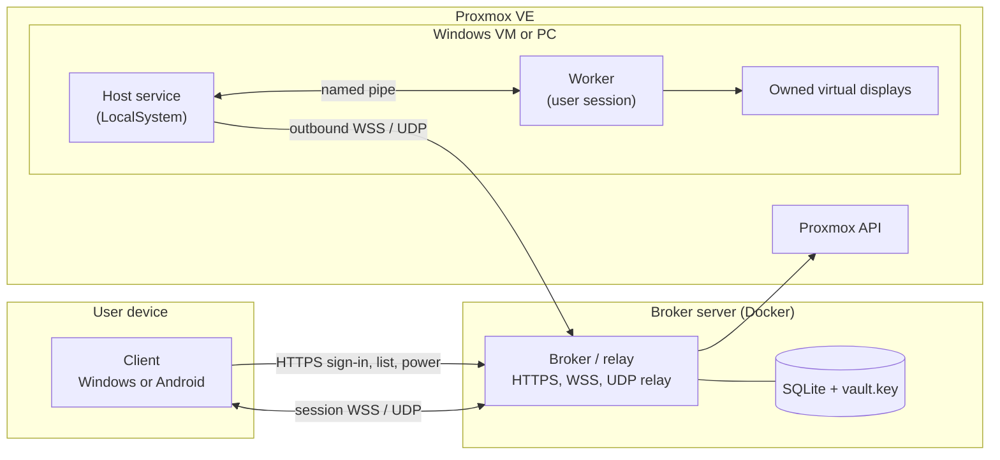

# Architecture

A short map of Multitap for people reading or changing the code. Wire details live in [docs/remote-session-protocol.md](docs/remote-session-protocol.md); the other design documents are listed at the end.

Every connection goes through the broker. Clients and Hosts only connect outwards, so neither needs an open port or a shared LAN.

## Broker and relay (`server/`)

One Node.js 24 process (`server/src/index.mjs`, dependency `ws` only) with a SQLite database (`node:sqlite`) in its data directory.

- **Accounts and assignments:** ID/password sign-in with bearer tokens; administrators assign VMs to accounts and grant per-account×VM permissions (clipboard directions and formats, drives, printers, USB devices), all default denied and enforced by the broker and again by the Host.
- **Proxmox:** one dedicated API identity, created by a short Proxmox Shell script the console prints. Its token is stored encrypted with `vault.key`. The broker synchronises the whole QEMU VM inventory, runs power actions (start, shutdown, reboot, stop) for assigned VMs, reads whether a VM has a sound device (the administrator adds one in Proxmox; Multitap does not change VM hardware) and opens the Proxmox VNC console.
- **Hosts:** a Host asks to enrol; an administrator approves it after comparing a verification code shown in Host settings and in the console. Physical Windows PCs (local PCs; the Korean screens say "로컬 PC") enrol the same way; their power actions go through the Host, and the broker wakes them with Wake-on-LAN.
- **VM state:** one state machine (`server/src/vm-state.mjs`) turns the broker's power tasks, the Proxmox status, the optional QEMU guest agent and Host channel events into the state a launcher card shows (off, starting, Windows starting, ready, in use, stopping and so on), with a fixed reason code and a revision that only grows. Clients get changes pushed over their live channel and poll gently only while it is down.
- **Relay:** `relay.mjs` pairs a client session WebSocket (`/api/v1/sessions/:id`) with the Host's outbound channel (`/api/v1/hosts/channel`) and, per session, the Host's WebSockets for clipboard, drives, printing, USB and independent video tracks (`/api/v1/hosts/sessions/:id/...`). It forwards control JSON and binary media, checks authorisation during the session and ends it when an assignment or permission is withdrawn. The UDP relay (`udp-relay.mjs`, a worker thread, on when `MULTITAP_UDP_PORT` is set; `compose.yaml` sets 18481) forwards datagrams between the two legs of a session after a ticket-proven bind.
- **Web:** the public homepage and download page (`/get/client`, `/get/host`, `/get/android`), the admin console (`server/admin/`) and the browser emergency console (noVNC 1.7.0, `server/admin/console/`).
- **Updates:** the broker serves the release catalog that clients and Hosts check, and it can update itself from signed server update packages (`server/update/`).

## Host (`apps/windows_host/`)

`MultitapHost.exe` runs in several roles:

- `--service`: the `MultitapHost` Windows service (LocalSystem, Session 0). Starts at boot, keeps the broker channel and the UDP media leg, holds the Host credential (machine DPAPI), installs Host updates and drivers, owns the display state, and starts a worker in the signed-in user's session.
- `--worker`: runs with the user's token in the interactive session. Captures the owned virtual displays (Windows Graphics Capture), encodes H.264 (x264; NVENC or AMF when a GPU is present; the Microsoft software encoder as fallback), captures sound (WASAPI) and encodes Opus, injects keyboard, mouse and touch input, and handles clipboard, drive, print and USB channels. Service and worker talk over a private named pipe; the worker never sees the Host credential.
- `--tray`: the per-login tray icon. Host settings are `MultitapHostSettings.exe`, the Flutter client binary in Host-settings mode.

The Host installer (`Multitap-Host-<version>-windows-x64.exe`, `apps/windows_host/installer/host_installer.cpp`, built by `tools/host-installer/`) carries the Host's Windows Installer package and runs it with msiexec. The package holds the program files and the service. What a first install needs besides them (the virtual display driver with its one certificate consent, and WinFsp) is finished by Host settings, which an interactive install opens when it succeeds.

### Displays

Streaming captures only displays that Multitap owns: one virtual output per client monitor (one or two), sized to the client window.

- The native provider uses the libvirtualdisplay control SDK (linked statically, `drivers/display_bridge/`) with the upstream SunshineVirtualDisplayDriver. Its catalog is signed with the upstream project's own release certificate; Host settings shows that signer and, after the administrator's consent, adds it to the machine's Root and TrustedPublisher stores before installing the driver. The older MttVDD driver (SignPath-signed) with its helper (`drivers/virtual_display/`) stays as the legacy provider. Both driver packages ship as the unmodified upstream files.
- Display manager v2 ([docs/display-manager-v2.md](docs/display-manager-v2.md)): before a stream the Host saves the Windows display configuration, makes the owned outputs the active desktop and switches every other display off for the stream (the Proxmox console, a vGPU head, a physical monitor). On stop, failure or after a crash it restores the saved configuration. Leftover state never blocks the service.

## Multitap streaming

1. The client asks the broker to connect (`POST /api/v1/desktops/:id/connect`) with its stream options; the broker checks account, assignment, VM state and Host capabilities and returns a session.
2. The broker sends `session.start` to the Host; the service prepares the displays and the worker starts capture and encoding at the client's viewport size.
3. Media flows Host → broker → client over WSS: a 12-byte binary header (type, flags, presentation time) and an H.264 Annex B or audio payload. Input, statistics, clipboard and the other channels are JSON control messages on the same sessions.
4. **UDP path (`udp-media-v1`):** when the Host, the client and the broker all support it, media moves to UDP through the broker's UDP relay. Framing, fragmentation, NACK and keyframe recovery are in `native/windows_video/udp_media.hpp` (shared by Host and Windows client, mirrored in the Android Kotlin code). Datagrams are sealed with AES-256-GCM under keys agreed by X25519 through the broker (`udp_media_crypto.hpp`), so the protection is per session but not end-to-end against the broker. Any failure keeps or puts the session back on WSS.
5. The client decodes (Media Foundation on Windows, MediaCodec on Android), presents frames and sends feedback for adaptive bitrate (`bitrate-adaptive-v1`). Resizing the window changes the real virtual display mode, followed by a new keyframe.

Static regions can be refreshed losslessly (`tiles-v1`, [docs/lossless-tiles-design.md](docs/lossless-tiles-design.md)). For games the client can hand the mouse over as raw relative movement, or as a virtual USB HID mouse through the USB channel when that permission is granted.

## Clients (`apps/windows_client/`)

One Flutter code base (`lib/`) for the Windows and Android apps and the Host settings window.

- **Windows:** the C++ runner (`windows/runner/`) holds the native parts: H.264 and Opus decoding, keyboard capture for Windows shortcuts, the clipboard with on-paste file transfer, shared drives, printing (the VM's Multitap print queue → PDF → a local printer), USB capture through UsbDk, the UDP media leg and the WebView2 browser console. The client runs unelevated and asks for administrator approval only when an action needs it.
- **Android:** Kotlin code in `android/` (MediaCodec decoding, Opus, UDP, clipboard, shared folders in `AndroidDrive.kt`, printing, TV support) behind the same Flutter UI.

## Device redirection

| Channel | PC side | VM side |
|---|---|---|
| Clipboard | text, images, file lists; files are pulled when pasted | same, with virtual files in Explorer |
| Drives | the client serves chosen folders | WinFsp drive (WebDAV fallback) |
| Printing | prints the PDF on a local printer | the Multitap print queue, named `Multitap 프린터 (PC)` in Windows (a literal name, the same in both languages) |
| USB | UsbDk captures the device | usbip-win2 virtual USB controller |

Each channel needs its per-account×VM permission and runs only inside an authorised session.

## Emergency console

The broker opens the Proxmox VNC console of an assigned VM and relays it to the noVNC page under `/console`, which the clients show in a WebView after a short-lived single-use grant. It works without the Host, for example when Windows does not start.

## Updates and signing

Windows installers and the server update packages are signed with the project's own Ed25519 keys. Clients and Hosts verify installers against the public key pinned in `native/windows_admin/release_signature.hpp` before running them. Updates are offered, never installed silently, except that an administrator (or an account the VM is assigned to) may push the newest Host to that VM.

## Further reading

[docs/multitap-streaming.md](docs/multitap-streaming.md) (engine), [docs/remote-session-protocol.md](docs/remote-session-protocol.md) (wire contract), [docs/adaptive-bitrate.md](docs/adaptive-bitrate.md), [docs/x264-encoder.md](docs/x264-encoder.md), [docs/display-manager-v2.md](docs/display-manager-v2.md), [docs/streaming-redirection.md](docs/streaming-redirection.md), [docs/drive-redirection.md](docs/drive-redirection.md), [docs/print-redirection.md](docs/print-redirection.md), [docs/usb-redirection.md](docs/usb-redirection.md), [docs/browser-console-v1.md](docs/browser-console-v1.md), [docs/server-access-v1.md](docs/server-access-v1.md), [guide chapter 5](docs/guide/en/05-users-and-desktops.md) (admin console).
