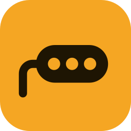
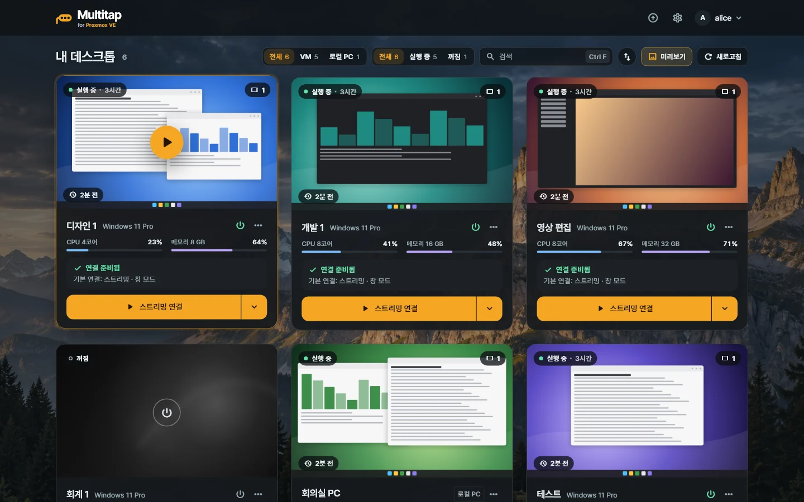
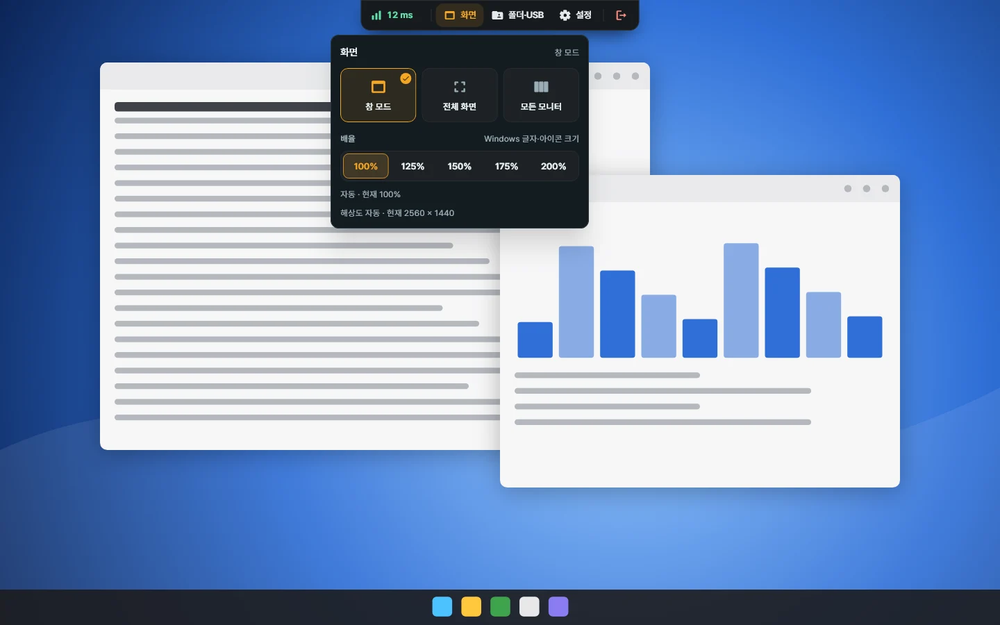

<p align="center"></p>

<h1 align="center">Multitap</h1>

<p align="center"><b>Proxmox VE용 셀프 호스팅 VDI.</b><br>Proxmox VE의 Windows 데스크톱을 직접 운영하는 서버 하나로 Windows·Android 앱에서 씁니다.</p>

<p align="center">
  <a href="https://multitap.me/ko/">홈페이지</a> ·
  <a href="https://multitap.me/ko/guide/">가이드</a> ·
  <a href="https://github.com/totblabs/Multitap/releases">다운로드</a> ·
  <a href="CHANGELOG.ko.md">바뀐 내용</a> ·
  <a href="https://github.com/totblabs/Multitap/discussions">Discussions</a> ·
  <a href="README.md">English</a>
</p>

<p align="center"></p>
<p align="center"><sub>Windows 앱의 데스크톱 목록입니다. 예제 데이터이고, 카드 안의 그림은 그려 넣은 예시입니다.</sub></p>

<p align="center"></p>
<p align="center"><sub>화면 패널을 연 세션 툴바입니다. 뒤의 데스크톱은 그려 넣은 예시이고, 실제 연결을 찍은 화면이 아닙니다.</sub></p>

## 무엇인가요

**Multitap이 하는 일**

- 사람마다 배정한 Windows 데스크톱을 쓰던 상태 그대로 이어서 씁니다. Proxmox VE의 Windows VM과, Host를 설치한 실제 Windows PC가 데스크톱이 됩니다.
- 자체 스트리밍(H.264 영상, Opus 소리)을 직접 운영하는 서버가 중계합니다. 앱과 데스크톱은 그 서버로 나가는 연결만 하므로, 포트를 열거나 같은 LAN에 있을 필요가 없습니다.
- Windows와 Android 앱이 있습니다.
- 관리자 페이지에서 계정, 배정, 전원, Proxmox 콘솔, 모니터링을 다루고, 계정마다 2단계 로그인을 켤 수 있습니다.

**Multitap이 하지 않는 일**

- 풀 관리. 데스크톱 풀이나 쓰고 나면 초기화되는 데스크톱이 없고, 관리자 페이지에서 VM을 만들거나 복제하지 않습니다. VM은 Proxmox VE에서 만듭니다.
- Linux 데스크톱. Host는 Windows에서만 동작합니다.
- macOS, iOS, Linux, 웹 브라우저용 클라이언트. 없고, 만들 계획도 없습니다.
- 디렉터리 연동. 계정은 Multitap 안에 있고 LDAP, SSO, OIDC는 없습니다.
- 데스크톱에서 마이크나 웹캠 쓰기.
- 종단 간 암호화. 직접 운영하는 중계 서버는 지나가는 내용을 볼 수 있습니다. [보안](#보안)을 보세요.

**이런 분께 맞습니다:** 집이나 연구실, 작은 사무실에서 Proxmox VE를 직접 운영하면서, 직접 운영하는 서버만으로 사람마다 Windows 데스크톱을 나눠 주려는 분.

## 주요 기능

- **GPU가 없어도 됩니다.** Host가 CPU로 인코딩하고(x264), 데스크톱에 NVIDIA·AMD·Intel GPU가 있으면 그 인코더를 씁니다. 해상도는 클라이언트 창 크기를 따릅니다.
- **화면 한 개나 두 개.** Multitap이 만든 가상 화면으로 스트리밍하고, Windows 앱은 모니터 두 대에 하나씩 띄울 수 있습니다.
- **계정과 데스크톱마다 따로 정하는 권한.** 관리자가 허용하기 전에는 모두 꺼져 있습니다: 글자 복사, 파일·그림 복사(방향별로 따로), 공유 폴더, 프린터, USB 장치.
- **복사, 폴더, 프린터, USB.** 파일까지 복사·붙여넣기, 공유 폴더, 앞에 있는 프린터로 인쇄, USB 장치 연결. Android에서는 글자 복사, 공유 폴더, 인쇄가 됩니다.
- **Proxmox 전원과 Console.** 배정된 VM을 켜고, 끄고, 다시 시작하고, 정지합니다. Windows가 잠기거나 켜지지 않을 때는 긴급 Console(Proxmox VNC 콘솔)을 엽니다.
- **2단계 로그인.** 인증 앱과 복구 코드로, 사용자와 관리자 모두 켤 수 있습니다.
- **모니터링과 공지.** 로그인·연결 내역, 사람별·데스크톱별 연결 시간, 로그인한 사람에게 보내는 공지.
- **확인하는 업데이트.** Windows 앱과 Host 업데이트는 프로젝트 자체 Ed25519 배포 서명으로 확인합니다. 일반 Host 업데이트는 Windows를 다시 시작하지 않습니다.

모든 화면은 한국어와 영어로 나옵니다.

## 필요한 것과 한계

| 구성 | 필요한 것과 되는 범위 |
| --- | --- |
| 서버 | 2코어, 메모리 2 GB, 디스크 10 GB인 CT나 VM. OS는 Debian이나 Ubuntu, x86_64(amd64). 서버 컨테이너는 메모리를 512 MB까지 쓰고, `MULTITAP_MEMORY_LIMIT`으로 올립니다 |
| Proxmox VE | 8 또는 9. 서버에서 API에 접속할 수 있어야 합니다(기본 8006 포트) |
| 데스크톱(Host) | Windows 10·11 x64. Proxmox VM이나 실제 PC |
| 클라이언트 | Windows 10·11 x64. Android 8.0(API 26) 이상 |
| 화면과 소리 | H.264, 30 또는 60fps, 4~100 Mbps(기본은 자동), 소리는 Opus. 해상도는 클라이언트 창 크기를 따릅니다 |
| 화면 수 | 연결 하나에 한 개나 두 개. 두 개는 Windows 앱과 모니터 두 대가 필요합니다 |
| 동시 연결 | 데스크톱 하나에 한 번에 하나 |
| 포트 | TCP 18480(관리자 페이지, 앱, Host)과 UDP 18481(미디어. 닿지 않으면 TCP로 연결) |
| HTTPS에서만 | Console과 2단계 로그인은 HTTPS 주소에서만 됩니다 |

## 설치

Proxmox VE 안의 Debian 또는 Ubuntu CT나 VM의 root 셸에서 한 줄을 실행합니다. Proxmox 노드의 셸이 아닙니다.

```sh
curl -fsSL https://raw.githubusercontent.com/totblabs/Multitap/main/deploy/docker/install.sh | MULTITAP_LANG=ko bash
```

Docker가 없으면 설치하고 서버를 시작한 뒤, 열 주소와 처음 로그인, 일회용 설정 코드를 보여 줍니다. 그다음은 관리자 페이지의 **시작하기**가 Proxmox 연결, 데스크톱마다 Host 설치, 사용자 배정까지 안내합니다. 앱과 Host는 설치한 서버에서 받거나 [Releases](https://github.com/totblabs/Multitap/releases)에서 받습니다.

### 이 명령이 하는 일

[`install.sh`](deploy/docker/install.sh)는 먼저 root인지, Debian·Ubuntu(x86_64)인지, CT라면 nesting이 켜졌는지 확인하고, 아니면 아무것도 설치하지 않고 멈춥니다. 그다음:

- `docker compose`가 없으면 Docker를 설치합니다. Docker 공식 저장소(`download.docker.com`)에서, 안 되면 배포판의 `docker.io` 패키지로 설치합니다.
- 최신 릴리스 태그에서 `compose.yaml`, `.env.example`, `multitap` 명령을 받고, 이미지 `ghcr.io/totblabs/multitap-broker`는 GitHub 컨테이너 저장소에서 받습니다.
- `/opt/multitap`, `/usr/local/bin/multitap`, Docker 볼륨 `multitap-broker-data`, 기록 `/var/log/multitap-install.log`를 만듭니다.
- Docker가 TCP 18480과 UDP 18481을 열고, 두 가지를 묻습니다: 같은 네트워크 주소(Enter는 예), 밖에서 오는 HTTP(Enter는 아니요). 둘째 질문을 위해 `1.1.1.1`에 공인 IP를 한 번 묻습니다.

Docker와 서버 컨테이너 말고는 서비스를 만들지 않고, 로그인 계정이나 SSH 키를 만들지 않으며, 사용 통계를 보내지 않습니다. `multitap uninstall`은 컨테이너와 명령을 지우고, 데이터 볼륨과 `/opt/multitap`, Docker는 남깁니다.

실행하기 전에 읽어 보려면:

```sh
curl -fsSLo install.sh https://raw.githubusercontent.com/totblabs/Multitap/main/deploy/docker/install.sh
less install.sh
MULTITAP_LANG=ko bash install.sh
```

서버 이미지는 공개된 [이미지 작업](.github/workflows/broker-image.yml)이 릴리스 태그의 소스로 만들고, 이미지의 `org.opencontainers.image.revision` 라벨에 만든 커밋이 적힙니다. 컨테이너는 root가 아닌 사용자로, 읽기 전용으로, 모든 권한(capability)을 뺀 채 돕니다([compose.yaml](compose.yaml)). 모든 코드가 AGPL-3.0 오픈 소스이므로 실행하기 전에 한 줄씩 읽어 볼 수 있습니다.

## 문서

- **[홈페이지의 가이드](https://multitap.me/ko/guide/)**: 여기서 시작하세요. 설치부터 첫 연결까지 짧은 아홉 장입니다.
- [이 저장소의 가이드북](docs/guide/README.md): 화면과 설정을 모두 다룬 자세한 참고서입니다([English](docs/guide/en/README.md)).
- [ARCHITECTURE.md](ARCHITECTURE.md): 코드를 읽는 사람을 위한 구조 설명입니다(영어).
- [docs/building.md](docs/building.md#소스에서-빌드): 서버, 앱, Host를 소스에서 빌드하는 방법입니다.
- [docs/docker-deployment.md](docs/docker-deployment.md): Docker Compose로 서버를 직접 운영하는 방법입니다.
- [CHANGELOG.ko.md](CHANGELOG.ko.md): 릴리스마다 바뀐 내용입니다.

질문과 제안은 [Discussions](https://github.com/totblabs/Multitap/discussions)에, 버그는 [Issues](https://github.com/totblabs/Multitap/issues)에 남겨 주세요. 변경을 보내는 방법은 [CONTRIBUTING.md](CONTRIBUTING.md#기여하기)에 있습니다.

## 보안

모든 연결은 직접 운영하는 서버를 거치고, 그 서버는 중계하는 내용을 볼 수 있습니다. HTTPS를 쓰고, 서버 운영자를 믿을 수 있는 환경에서 쓰세요. 서버가 기록하는 것, 연결하는 곳, Host가 Windows에서 바꾸는 것은 [보안 안내](https://multitap.me/ko/security/)와 [가이드 10장](docs/guide/10-보안-안내.md)에 있습니다.

취약점은 공개 이슈 대신 [SECURITY.md](SECURITY.md#보안-문제-알리기)의 방법으로 비공개로 알려 주세요.

## 상태

개인이 만들고 실제로 쓰는 프로젝트입니다. 앞선 버전들은 비공개로 개발했고 1.1.1이 처음 공개한 릴리스이며, 이 저장소에는 릴리스마다 커밋 하나가 들어옵니다.

## 라이선스

Multitap은 [GNU AGPL v3](LICENSE)만으로 배포하며(SPDX: `AGPL-3.0-only`) 어떤 보증도 없습니다. "Multitap"이라는 이름과 로고를 수정한 버전에 원본인 것처럼 보이게 쓰는 것은 허락하지 않습니다. 함께 쓰는 외부 구성요소와 각 라이선스는 [THIRD_PARTY_NOTICES.md](THIRD_PARTY_NOTICES.md)에 있습니다.

Multitap은 Proxmox VE를 위한 독립 도구입니다. Proxmox Server Solutions GmbH가 만들거나 보증한 제품이 아니며, 제휴 관계도 없습니다.
