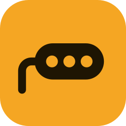
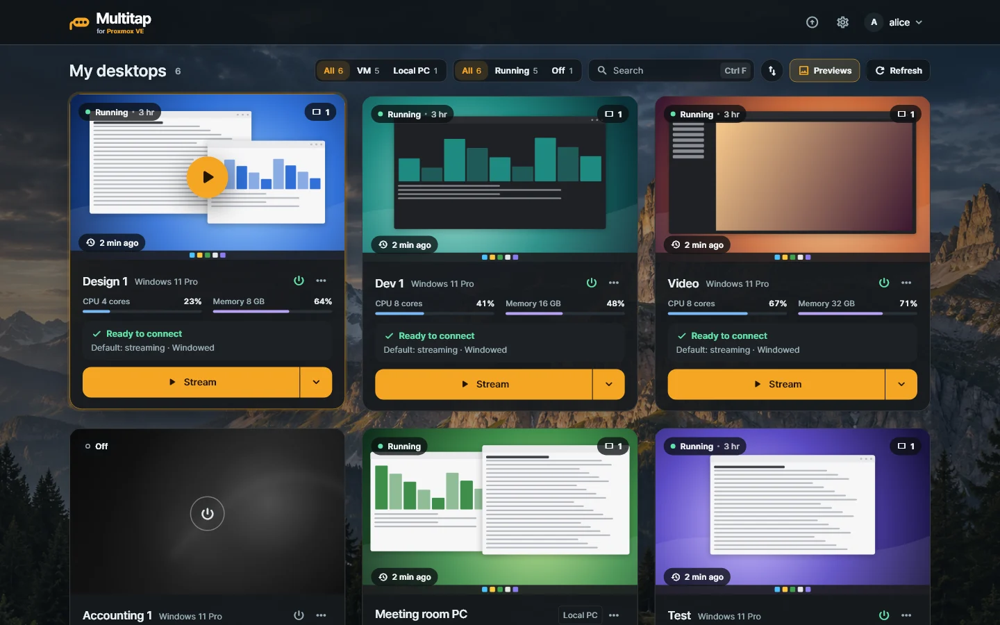
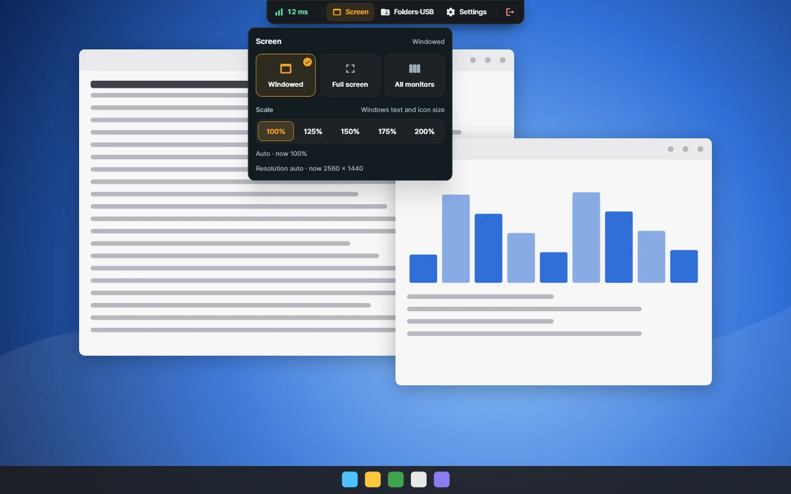

<p align="center"></p>

<h1 align="center">Multitap</h1>

<p align="center"><b>Self-hosted VDI for Proxmox VE.</b><br>Windows desktops on your Proxmox VE, in Windows and Android apps, through one server you run.</p>

<p align="center">
  <a href="https://multitap.me/en/">Website</a> ·
  <a href="https://multitap.me/en/guide/">Guide</a> ·
  <a href="https://github.com/totblabs/Multitap/releases">Download</a> ·
  <a href="CHANGELOG.md">Changelog</a> ·
  <a href="https://github.com/totblabs/Multitap/discussions">Discussions</a> ·
  <a href="README.ko.md">한국어</a>
</p>

<p align="center"></p>
<p align="center"><sub>The desktop list in the Windows app, with sample data. The pictures on the cards are drawn stand-ins.</sub></p>

<p align="center"></p>
<p align="center"><sub>The session toolbar with its Screen panel open. The desktop behind it is a drawn stand-in, not a captured session.</sub></p>

## What it is

**Multitap is**

- Windows desktops assigned to people, each keeping its own state: Windows VMs on Proxmox VE, and physical Windows PCs with the Host installed.
- Its own streaming (H.264 video, Opus sound), relayed by the server you host. Apps and desktops only connect out to that server, so they need no open port and no shared LAN.
- Apps for Windows and Android.
- An admin console for accounts, assignment, power, the Proxmox console and monitoring, with two-step sign-in for each account.

**Multitap is not**

- A pool manager. There are no desktop pools and no desktops that reset after use, and the console does not create or clone VMs. You make the VMs in Proxmox VE.
- For Linux desktops. The Host runs on Windows only.
- Available for macOS, iOS, Linux or the browser. Those clients do not exist and none are planned.
- Connected to a directory. Accounts live in Multitap; there is no LDAP, SSO or OIDC.
- A way to use a microphone or webcam in the desktop.
- End-to-end encrypted. The relay you run can see the stream; see [Security](#security).

**Who it is for:** people who run Proxmox VE at home, in a lab or in a small office and want to give each person a Windows desktop from a server of their own.

## Features

- **No GPU needed.** The Host encodes on the CPU (x264) and uses an NVIDIA, AMD or Intel GPU encoder when the desktop has one. The resolution follows the client window.
- **One or two screens.** Streaming uses virtual displays that Multitap owns; the Windows app can put one on each of two monitors.
- **Permissions for each account on each desktop**, all off until an administrator allows them: copying text, copying files and images (each direction separately), shared folders, printers and USB devices.
- **Clipboard, folders, printing, USB.** Copy and paste including files, shared folders, printing to a printer on your side, and USB redirection. On Android: text, shared folders and printing.
- **Proxmox power and Console.** Start, shut down, restart and stop assigned VMs, and open the emergency Console (the Proxmox VNC console) when Windows is locked or does not start.
- **Two-step sign-in** with an authenticator app and recovery codes, for users and administrators.
- **Monitoring and notices.** Sign-in and connection history, connection time for each person and desktop, and notices to people who are signed in.
- **Checked updates.** Windows app and Host updates are verified against the project's own Ed25519 release signature. A normal Host update does not restart Windows.

Everything is in Korean and English.

## Requirements and limits

| Part | What it needs, and how far it goes |
| --- | --- |
| Server | A CT or VM with 2 cores, 2 GB of memory and 10 GB of disk, running Debian or Ubuntu on x86_64 (amd64). The server container is limited to 512 MB of memory unless you raise `MULTITAP_MEMORY_LIMIT` |
| Proxmox VE | Version 8 or 9, with its API reachable from the server (port 8006 by default) |
| Desktop (Host) | Windows 10 or 11, x64, as a Proxmox VM or a physical PC |
| Clients | Windows 10 or 11, x64. Android 8.0 (API 26) or later |
| Video and sound | H.264 at 30 or 60 fps and 4 to 100 Mbps (automatic by default), Opus sound. The resolution follows the client window |
| Screens | One or two for a connection. Two need the Windows app and two monitors |
| Connections | One at a time for each desktop |
| Ports | TCP 18480 (console, apps, Hosts) and UDP 18481 (media; without it, connections stay on TCP) |
| HTTPS only | The Console and two-step sign-in work only at an HTTPS address |

## Install

Run one line in a root shell inside a Debian or Ubuntu CT or VM on your Proxmox VE, not on the Proxmox node itself:

```sh
curl -fsSL https://raw.githubusercontent.com/totblabs/Multitap/main/deploy/docker/install.sh | bash
```

It installs Docker if it is missing, starts the server and shows the address to open, the first sign-in and a one-time setup code. From there, **Getting started** in the admin console takes you through connecting Proxmox, installing the Host in each Windows desktop and assigning desktops to people. The apps and the Host are downloaded from your own server, or from [Releases](https://github.com/totblabs/Multitap/releases).

### What the install line does

[`install.sh`](deploy/docker/install.sh) first checks that it runs as root on Debian or Ubuntu (x86_64) and, in a CT, that nesting is on; if not, it stops before installing anything. Then it:

- installs Docker if `docker compose` is missing: from Docker's repository (`download.docker.com`), or the distribution's `docker.io` package when that fails;
- downloads `compose.yaml`, `.env.example` and the `multitap` command from the newest release's tag, and the image `ghcr.io/totblabs/multitap-broker` from GitHub's container registry;
- creates `/opt/multitap`, `/usr/local/bin/multitap`, the Docker volume `multitap-broker-data` and the log `/var/log/multitap-install.log`;
- lets Docker publish TCP 18480 and UDP 18481, and asks two questions: the address on your network (Enter = yes) and HTTP from outside (Enter = no). For the second, it asks `1.1.1.1` once for the public IP.

It adds no service other than Docker and the server container, no login accounts or SSH keys, and sends no usage data. `multitap uninstall` removes the container and the command; the data volume, `/opt/multitap` and Docker stay.

To read it before you run it:

```sh
curl -fsSLo install.sh https://raw.githubusercontent.com/totblabs/Multitap/main/deploy/docker/install.sh
less install.sh
bash install.sh
```

The server image is built from the release tag by the public [image workflow](.github/workflows/broker-image.yml), and its `org.opencontainers.image.revision` label names the commit it was built from. The container runs as a user other than root, read-only, with every capability dropped ([compose.yaml](compose.yaml)). Everything here is open source under the AGPL-3.0, so every line can be read before it runs.

## Documentation

- **[Guide on the website](https://multitap.me/en/guide/)**: start here. Nine short chapters from install to the first connection.
- [Guide chapters in this repository](docs/guide/en/README.md): the detailed reference, with every screen and setting ([한국어](docs/guide/README.md)).
- [ARCHITECTURE.md](ARCHITECTURE.md): how the parts fit together, for people reading the code.
- [docs/building.md](docs/building.md): building the server, the apps and the Host from source.
- [docs/docker-deployment.md](docs/docker-deployment.md): running the server with Docker Compose by hand. It is in Korean and ends with an English summary.
- [CHANGELOG.md](CHANGELOG.md): what changed in each release.

Questions and ideas go to [Discussions](https://github.com/totblabs/Multitap/discussions), bugs to [Issues](https://github.com/totblabs/Multitap/issues). [CONTRIBUTING.md](CONTRIBUTING.md) says how to send a change.

## Security

Every connection goes through the server you run, and that server can see what it relays: use HTTPS, and run it where you trust the operator. What the server records, what it contacts and what the Host changes in Windows are on the [security page](https://multitap.me/en/security/) and in [guide chapter 10](docs/guide/en/10-security.md).

Report a vulnerability privately, as [SECURITY.md](SECURITY.md) describes, not in a public issue.

## Status

Multitap is a personal project in real use. It was developed privately through its earlier versions; 1.1.1 was the first public release, and this repository receives one commit for each release.

## License

Multitap is licensed under the [GNU AGPL version 3](LICENSE) only (SPDX: `AGPL-3.0-only`) and comes with no warranty. The name "Multitap" and its logo may not be used on modified versions in a way that suggests they are the original. Third-party components and their licenses are listed in [THIRD_PARTY_NOTICES.md](THIRD_PARTY_NOTICES.md).

Multitap is an independent tool for Proxmox VE. It is not made or endorsed by, or affiliated with, Proxmox Server Solutions GmbH.
