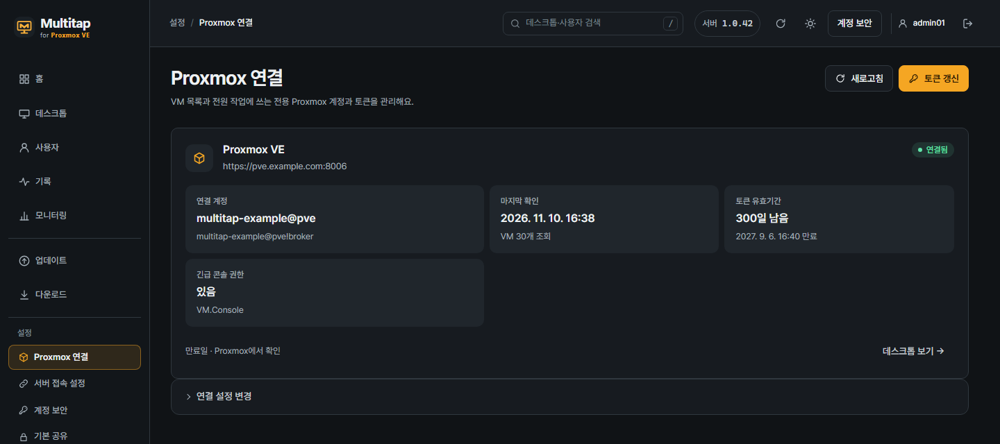
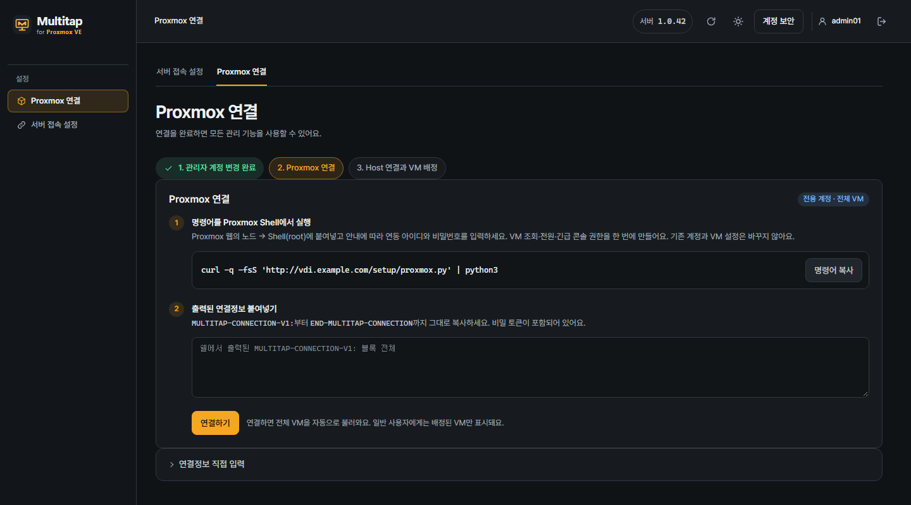

# 3. Proxmox 연결

[목차](README.md) · [이전: 서버 설치](02-서버-설치.md) · [다음: Host 설치](04-Host-설치.md) · [English](en/03-connect-proxmox.md)

서버를 Proxmox VE에 연결하면 QEMU VM 목록을 자동으로 가져옵니다.
사용자에게 보여 줄 데스크톱은 그다음에 따로 배정합니다.

**목표:** Multitap 서버가 Proxmox의 VM 목록·전원·Console을 다룰 수 있게 연결합니다.
필요한 권한은 명령 한 번으로 모두 만들어집니다. 나중에 따로 추가할 권한은 없습니다.
PC 브라우저에 **Multitap 관리자 페이지**와 **Proxmox 웹**을 각각 열어 두세요.

| 열어 둘 화면 | 이 장에서 하는 일 |
| --- | --- |
| Multitap 관리자 페이지 | 설정 명령어 복사 → 연결 설정 붙여넣기 |
| Proxmox 웹의 노드 **Shell** | 전용 연동 계정 만들기 |

이 장의 명령은 **Proxmox 노드의 Shell**에 입력합니다.
앞 장에서 사용한 Linux 서버 터미널이나 Windows VM 콘솔과 구분하세요.

위 그림은 **연결을 마친 뒤의 예시**입니다.
처음에는 아래와 같은 연결 설정 화면이 보입니다.

## 1단계. 설정 명령어 복사

1. Multitap 관리자 페이지에 로그인하세요.
2. 왼쪽 메뉴의 **Proxmox 연결**을 여세요.
3. **명령어 복사**를 누르세요.
4. Proxmox 웹에서 VM을 관리하는 노드를 선택하세요.
5. 노드의 **Shell**을 여세요.
6. root Shell에 복사한 명령어를 붙여넣으세요.
7. Enter를 누르세요.

명령어는 현재 Multitap 서버에서 설정 스크립트를 받습니다.
문서의 예시 명령보다 관리자 페이지에 표시된 명령어를 사용하세요.
**여기는 Multitap 서버입니다** 또는 **여기는 Proxmox 노드가 아닙니다**가 나오면 다른 곳에 붙여 넣은 것입니다. Proxmox 노드의 **Shell**에서 다시 실행하세요.

Proxmox의 왼쪽 목록에서 **Datacenter 아래의 서버 이름**이 노드입니다.
그 아래 Windows VM을 고르면 노드의 **Shell** 대신 VM의 **Console**이 나오므로 위치를 다시 확인하세요.

## 2단계. 전용 API 계정 만들기

1. **[1/3] Proxmox 주소**에서 자동으로 찾은 주소에 **✔**가 보이면 그대로 진행합니다.
2. **⚠**와 함께 주소를 물으면 평소 브라우저에서 여는 Proxmox 관리 주소를 입력하세요.
3. **[2/3] 연동 계정**에서 **새 연동 아이디**를 입력하세요. Enter만 누르면 괄호 안의 이름을 씁니다.
4. 화면에 나온 생성 내용과 권한을 확인하세요.
5. 생성하려면 `y`를 입력하세요.
6. 새 연동 계정의 비밀번호를 입력하세요.
7. 같은 비밀번호를 다시 입력하세요.

비밀번호를 입력해도 화면에는 글자가 보이지 않습니다.
아이디에는 `multitap-` 접두사가 자동으로 붙습니다.
주소를 처음부터 정하려면 명령 끝에 주소를 붙이세요. 예: `… --lang ko https://pve.example.com:8006` (맨 끝에 주소만 띄어 붙입니다)

**새 연동 아이디**는 Multitap 서버가 Proxmox에 접속할 때 쓸 전용 이름입니다.
이미 사용하는 Proxmox 관리자 아이디와 다른 새 이름을 정하세요.

> Proxmox 주소와 Multitap 주소는 서로 다릅니다.
> VM을 관리하는 Proxmox 주소를 입력하세요.

스크립트는 전용 사용자와 역할, API 토큰을 만듭니다.
역할에는 VM 조회·전원·Console 권한이 처음부터 들어 있습니다.
기존 계정을 덮어쓰거나 VM 전원·구성을 바꾸지는 않습니다.

안내 언어는 명령의 `--lang ko`나 `--lang en`을 따릅니다. 없으면 Shell의 언어 설정을 따르고, 한국어가 아니면 영어로 나옵니다.

## 3단계. 연결 설정 붙여넣기

1. Shell 출력에서 `MULTITAP-CONNECTION-V1:`부터 `END-MULTITAP-CONNECTION`까지 복사하세요.
2. Multitap의 **Proxmox 연결** 화면으로 돌아오세요.
3. **출력된 연결 설정 붙여넣기** 칸에 전체 블록을 붙여넣으세요.
4. **연결하기**를 누르세요.
5. 위쪽의 연결 상태가 **연결됨**인지 확인하세요.

> 연결 설정에는 비밀 API 토큰이 들어 있습니다.
> 게시판·채팅에 올리거나 스크린샷에 포함하지 마세요.

**데스크톱** 목록에는 Host를 설치하고 승인한 VM만 나타납니다.
VM을 미리 가져올 필요는 없습니다. Host가 연결을 요청하면 서버가 Proxmox에서 그 VM을 찾습니다.
VM 생성·삭제는 Proxmox에서 진행하세요.

**완료 확인:** **Proxmox 연결** 화면에 **연결됨**이 보입니다.
다음 장에서 VM에 Host를 설치하면 **데스크톱**에 나타납니다.

**연결됨**이 보이면 [4장: Host 설치](04-Host-설치.md)로 이동하세요.

## 연결이 안 될 때

| 확인할 것 | 다음 행동 |
| --- | --- |
| 관리 주소 | 브라우저에서 쓰는 Proxmox 주소와 포트를 확인하세요. |
| 서버에서의 접근 | 브로커 컨테이너가 Proxmox 주소에 접속할 수 있는지 확인하세요. |
| 인증서 이름 | 주소와 인증서의 이름이 일치하는지 확인하세요. |
| 사설 CA | 설정 스크립트가 출력한 CA가 연결 설정에 포함됐는지 확인하세요. |

인증서 검증을 끄는 대신 주소와 인증서를 맞추세요.
직접 구성한 토큰이 있다면 **연결 설정 직접 입력**을 사용할 수 있습니다.

## 인증서와 토큰 경고

Proxmox 연결에 문제가 생기거나 만료가 다가오면 관리자 페이지 위쪽과 **홈**의 **지금 할 일**에 경고가 나옵니다.

| 경고 | 할 일 |
| --- | --- |
| **Proxmox 인증서가 바뀌었어요** | 전원·Console·상태 확인이 멈춘 상태입니다. **Proxmox 연결** 화면의 명령을 Proxmox 노드의 **Shell**에서 다시 실행하고, 나온 연결 설정을 **연결 설정 변경**에 붙여넣으세요. |
| **Proxmox 인증서가 만료됐어요** | Proxmox에서 인증서를 갱신한 뒤 같은 방법으로 연결 설정을 다시 붙여넣으세요. |
| **Proxmox 인증서를 확인하지 못했어요** | 위의 [연결이 안 될 때](#연결이-안-될-때) 표로 주소와 인증서를 확인하세요. |
| **Proxmox 인증서 만료 N일 전** | 연결 설정에 고정한 노드 인증서가 곧 만료됩니다. Proxmox에서 갱신하면 연결이 끊기므로, 갱신한 뒤 연결 설정을 다시 붙여넣으세요. |
| **Proxmox 토큰 만료 N일 전** | 아래의 **토큰 갱신**으로 유효기간을 늘리세요. |
| **Proxmox 토큰 또는 접근 권한을 확인하세요** | Proxmox가 저장된 토큰을 받지 않습니다(Proxmox에서 지웠거나, 다른 서버의 백업을 복원한 경우 등). **토큰 갱신**은 만료일만 늘리므로 **다시 연결**을 누르고, 나온 명령으로 새 연동 계정을 만들어 연결 설정을 붙여넣으세요. |

만료 경고는 30일 전부터 나오고, 7일 전부터는 빨간색입니다.
고정한 인증서의 만료일은 **Proxmox 연결** 화면의 **Proxmox 인증서** 줄에서 봅니다.

나중에 할 일: 토큰 유효기간 확인과 갱신

처음 만든 전용 계정과 토큰의 유효기간은 365일입니다.
왼쪽 메뉴의 **Proxmox 연결** 위쪽에서 만료일과 남은 일수를 확인할 수 있습니다.

1. **토큰 갱신**을 누르세요.
2. 화면에 나온 갱신 명령어를 복사하세요.
3. Proxmox 노드의 root **Shell**에서 명령어를 실행하세요.
4. Shell에 표시된 갱신 내용을 확인하세요.
5. 갱신하려면 `y`를 입력하세요.
6. 출력된 `MULTITAP-RENEWAL-V1:` 블록을 갱신 창에 붙여넣으세요.
7. **갱신 확인**을 누르세요.

갱신은 기존 계정과 토큰을 이어 씁니다.
비밀번호나 토큰 Secret을 새로 입력할 필요는 없습니다.

긴급 콘솔 권한이 없다고 나올 때

연동 계정에 긴급 콘솔 권한(`VM.Console`)이 없을 수도 있습니다.
이 권한이 없으면 사용자가 앱에서 Console을 열 수 없습니다.
그러면 **Proxmox 연결** 화면의 **긴급 콘솔 권한**이 **없음**으로 보이고, 그 아래에 안내와 명령이 한 번에 나옵니다.

1. 화면에 나온 명령을 **복사**하세요.
2. Proxmox 노드의 root **Shell**에서 실행하세요.
3. 표시된 내용을 확인하고 `y`를 입력하세요.
4. Multitap으로 돌아와 **권한 확인**을 누르세요.

**있음**으로 바뀌면 안내는 사라집니다.

Multitap 명령으로 만들지 않은 계정에는 명령이 나오지 않습니다.
Proxmox 관리자가 그 계정의 `/vms` 권한에 `VM.Console`을 직접 추가한 뒤 **권한 확인**을 누르세요.

자세히: 전용 계정의 권한

전용 계정은 `/vms` 아래의 현재·미래 VM에 상속 권한을 받습니다.

| 권한 | 쓰는 곳 |
| --- | --- |
| `VM.Audit` | VM 목록과 상태, 구성 읽기 |
| `VM.PowerMgmt` | 시작·종료·다시 시작·강제 종료 |
| `VM.Console` | Console (사용자가 앱에서 여는 Proxmox 콘솔) |
| `VM.GuestAgent.Audit` (Proxmox VE 9) 또는 `VM.Monitor` (Proxmox VE 8) | Windows가 켜졌는지 확인 |

VM 하드웨어를 바꾸는 권한은 받지 않습니다.
소리 장치(오디오 장치)는 Proxmox에서 VM의 **Hardware → Add → Audio Device**로 직접 추가하세요.
Multitap은 `VM.Config.HWType`을 쓰지 않습니다. 역할에 들어 있다면 Proxmox에서 빼도 됩니다.

이 Proxmox 권한과 Multitap 사용자 배정은 별개입니다.
일반 사용자는 Multitap에서 배정받은 데스크톱만 사용할 수 있습니다.

