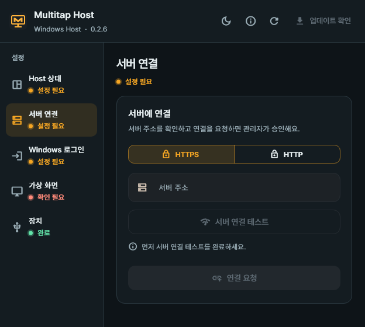
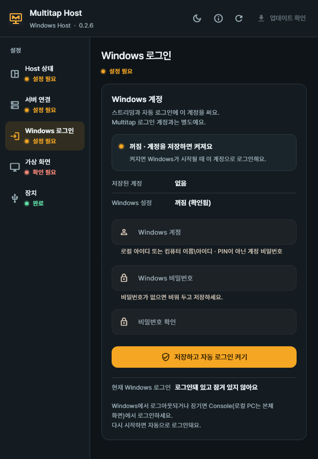
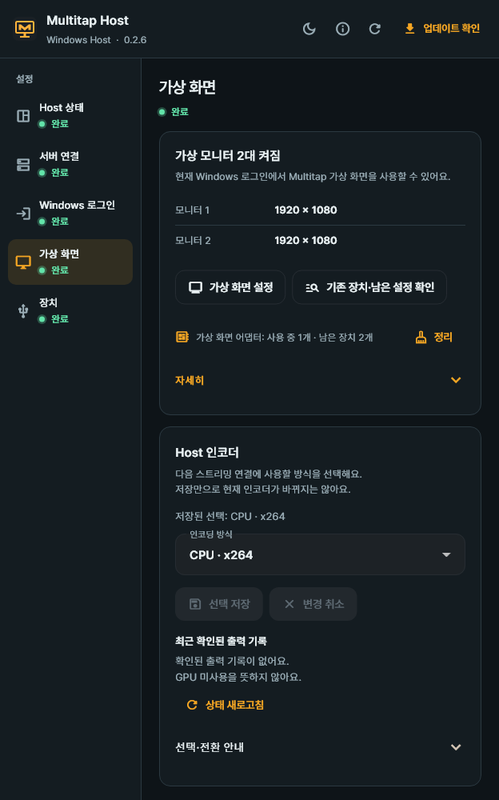
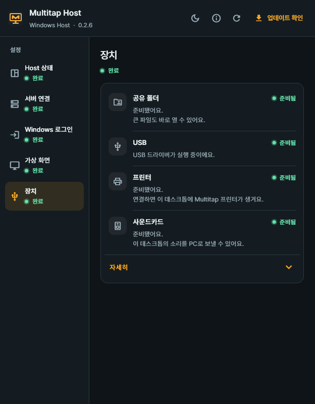

# 4. Host 설치 — VM과 로컬 PC

[목차](README.md) · [이전: Proxmox 연결](03-Proxmox-연결.md) · [다음: 사용자와 데스크톱 배정](05-사용자와-VM-배정.md) · [English](en/04-host-install.md)

Host는 데스크톱이 될 Windows 안에 설치합니다.
Proxmox VM과 실제 Windows PC 모두 같은 설치 파일을 사용합니다.

**목표:** Windows가 화면을 보낼 준비를 하고, 관리자가 그 Host를 승인합니다.
아래 순서로 **데스크톱이 될 Windows**와 **PC의 관리자 페이지**를 오갑니다.

| 순서 | 작업할 곳 | 할 일 |
| --- | --- | --- |
| 1~2단계 | 데스크톱이 될 Windows 안 | Host 설치와 설치 마무리 → 서버에 연결 요청 |
| 3단계 | PC의 관리자 페이지 | 확인 코드를 비교하고 승인 |
| 4~6단계 | 다시 그 Windows 안 | Windows 계정·가상 화면·장치 확인 |

VM이라면 Proxmox에서 해당 VM의 **Console**을 열어 Windows에 로그인하세요.
실제 PC라면 그 PC 앞에서 진행하세요.

## 1단계. 설치 파일 실행

**작업 위치: 데스크톱이 될 Windows 안**

1. 그 Windows에서 Multitap 서버의 Host 다운로드 주소를 여세요.

   ```text
   https://vdi.example.com/get/host
   ```

2. 받은 `Multitap-Host-<버전>-windows-x64.exe`를 실행하세요.
3. Windows의 관리자 권한 요청을 승인하세요.
4. 설치 진행 창이 닫힐 때까지 기다리세요. 따로 누를 버튼은 없습니다.
5. 설치가 끝나면 **Host 설정**이 자동으로 열립니다.

예시 도메인을 실제 서버 주소로 바꾸세요.
내부망 HTTP라면 `http://서버IP:18480/get/host`를 사용하세요.

Host는 일반 Windows 프로그램처럼 설치됩니다. 나중에 Windows 설정의 **앱**에서 복구하거나 제거할 수 있습니다.

### 설치 마무리 — 가상 화면 드라이버와 WinFsp

새 Windows에서는 Host 설정이 처음 열릴 때 설치 마무리를 스스로 시작합니다.

1. **가상 화면 드라이버의 서명을 신뢰할까요?** 창을 읽으세요.
2. **신뢰하고 설치**를 누르세요.
3. 가상 화면 드라이버와 공유 폴더 구성 요소(WinFsp)가 이어서 설치됩니다. 창을 닫지 말고 기다리세요.

동의는 이 한 번만 묻습니다.
가상 화면 드라이버는 Sunshine이 서명한 원본을 그대로 씁니다.
동의하면 그 서명 인증서 하나를 Windows 신뢰 저장소(Root·TrustedPublisher)에 넣습니다. 코드 서명 용도만 있는 인증서입니다.

취소했거나 실패했다면 **개요** 맨 위의 **설치 마무리 필요**에서 **설치 마무리**를 다시 누르세요.
Windows를 다시 시작하라는 안내가 나오면 작업을 저장한 뒤 다시 시작하세요. 자동으로 다시 시작하지는 않습니다.

**완료 확인:** Host 설정이 열려 있고 **설치 마무리 필요**가 보이지 않습니다.

## 2단계. 서버에 연결 요청

**작업 위치: 같은 Windows의 Host 설정**

시작 메뉴에서 **Multitap Host**를 찾아 여세요.
이미 실행 중이면 알림 영역의 Multitap 아이콘에서 **Host 설정 열기**를 선택하세요.

Host 설정의 언어는 위쪽의 **언어** 버튼에서 **자동**, **한국어**, **English** 중에 고릅니다. **자동**은 Windows 언어를 따릅니다.



1. Host 설정을 여세요.
2. **서버 연결**을 여세요.
3. **서버 주소**에 관리자가 정한 주소를 입력하세요.
4. **서버 연결 테스트**를 누르세요.
5. HTTP 주소라면 암호화 경고를 확인하세요.
6. 그 주소에서 HTTP를 사용할 경우 **이 주소에 HTTP 사용**을 누르세요.
7. **연결 요청**을 누르세요.
8. 화면의 **확인 코드**를 관리자에게 알려 주세요.

서버 주소 예시는 `https://vdi.example.com`입니다.
HTTP 전용 설치에서는 실제 서버의 `http://서버IP:18480` 주소를 사용합니다.

> Host 화면에 등록 코드를 입력하는 방식이 아닙니다.
> 관리자가 두 화면의 확인 코드를 비교한 뒤 승인합니다.

설정 창을 닫아도 Windows 서비스가 승인 결과를 계속 확인합니다.

**완료 확인:** 관리자 승인 대기 안내와 **확인 코드**가 보입니다.
아직 승인을 받지 않았으므로 이 상태만으로 연결 준비가 끝난 것은 아닙니다.

## 3단계. 관리자 승인

**작업 위치: PC 브라우저의 Multitap 관리자 페이지**

Host 창의 확인 코드와 관리자 페이지의 코드를 나란히 비교하세요.
승인을 기다리는 요청은 **홈**의 **지금 할 일**과 **데스크톱** 맨 위의 **승인 대기**에 나타납니다.

### Proxmox VM

1. 관리자 페이지의 **데스크톱**을 여세요.
2. 맨 위 **승인 대기**에서 요청의 Windows 이름을 확인하세요.
3. 요청의 **확인 코드**를 Host 화면과 비교하세요.
4. **Proxmox에서 찾은 VM**이 맞는지 확인하세요.
5. 코드가 같으면 **확인하고 승인**을 누르세요.
6. 대화상자의 **연결할 Proxmox VM**을 확인하세요.
7. **연결 승인**을 누르세요.
8. 목록에 그 데스크톱이 **접속 가능**으로 표시되는지 확인하세요.

> 코드가 다르면 승인하지 마세요.
> 같은 VM에 요청이 여럿이면 실제 Host 화면과 코드가 같은 요청을 고르세요.

요청에는 서버가 Proxmox에서 찾은 VM이 표시되므로 노드와 VM ID를 입력하지 않습니다.
VM을 찾지 못했다고 나오면 **직접 입력**을 눌러 Proxmox 노드와 VM ID를 넣고 **Host 화면 코드 확인**을 선택하세요.

기존 Host를 교체할 때만 **기존 Host 교체**를 선택하세요.
교체하면 기존 Host의 연결이 해제됩니다.

### 로컬 PC

1. 관리자 페이지의 **데스크톱**을 여세요.
2. 맨 위 **승인 대기**에서 등록할 Windows 이름을 확인하세요.
3. 요청의 **확인 코드**를 PC의 Host 화면과 비교하세요.
4. 코드가 같으면 같은 요청의 **로컬 PC로 등록**을 누르세요.
5. **PC 이름**을 입력하세요.
6. **Host 화면 코드 확인**에서 **Host 화면의 코드와 같음을 확인함**을 선택하세요.
7. **Proxmox 연결 없이 등록**에서 확인을 선택하세요.
8. **PC 등록**을 누르세요.
9. 목록에 그 PC가 **접속 가능**으로 표시되는지 확인하세요.

**로컬 PC로 등록**은 서버가 Proxmox에서 맞는 VM을 찾지 못한 요청에 나타납니다.

로컬 PC에는 Console이 없습니다.
전원 켜기는 PC의 Wake-on-LAN 준비와 서버의 LAN 접근 조건이 필요합니다.

**완료 확인:** 승인한 대상이 **데스크톱** 목록에 **접속 가능**으로 표시되고, Host에서도 승인이 반영됩니다.
VM·PC 등록 대상이 맞는지 다시 확인하세요.

### 복사한 VM

Host 등록은 승인받은 그 Windows에서만 쓰입니다.
등록된 VM을 복제해 만든 VM에서는 Host 설정에 **이 Windows는 등록된 다른 데스크톱을 복사한 것 같아요. 이 데스크톱의 연결을 새로 요청하세요.**가 나옵니다.

1. 복사한 VM의 Host 설정에서 **서버 연결**을 여세요.
2. **연결 요청**을 누르세요.
3. 관리자 페이지에서 다른 새 Host처럼 확인 코드를 비교하고 승인하세요.

원래 VM의 등록과 연결은 그대로입니다.
복사한 VM이 원래 등록으로 접속하려 하면 서버가 거절하고, **기록 → 관리 작업**에 **복사된 데스크톱의 Host 연결 거부**가 남습니다.

## 4단계. Windows 로그인 계정 저장

**작업 위치: 다시 그 Windows의 Host 설정**



위 그림은 **계정을 저장하기 전**의 화면입니다.
이미 계정이 저장돼 있고 바꾸려면 **계정 변경**을 누르세요.

여기에 넣는 계정은 이 Windows의 계정입니다.
관리자가 아닌 일반(표준) Windows 계정이어도 스트리밍할 수 있습니다.
Multitap에 로그인하는 계정과는 별개입니다.

Windows 로그인 때 쓰는 PIN 숫자를 넣으면 안 됩니다.
자동 로그인에 사용할 **실제 Windows 계정 비밀번호**를 준비하세요.

1. Host 설정의 **Windows 로그인**을 여세요.
2. **Windows 계정**에 로컬 아이디 또는 `컴퓨터 이름\아이디`를 입력하세요.
3. **Windows 비밀번호**에 계정 비밀번호를 입력하세요.
4. **비밀번호 확인**에 같은 비밀번호를 입력하세요.
5. **저장하고 자동 로그인 켜기**를 누르세요.
6. 확인 창의 계정과 자동 로그인 안내를 확인하세요.
7. 확인 창의 **저장하고 켜기**를 누르세요.
8. 계정 저장 결과와 자동 로그인 결과를 각각 확인하세요.

**완료 확인:** 저장한 계정 이름과 자동 로그인 적용 결과를 확인했습니다.
실패나 일부만 저장됐다는 안내가 있으면 그 안내의 다음 행동을 먼저 진행하세요.

> PIN 대신 Windows 계정 비밀번호를 사용하세요.
> 저장하면 Windows 시작 시 이 계정으로 자동 로그인합니다. 잠금 해제는 별도입니다.

Windows 정책 때문에 자동 로그인을 적용할 수 없으면 **계정 확인·저장**으로 표시될 수 있습니다.
계정만 저장됐다는 안내를 자동 로그인 완료로 보지 마세요.

이 경우 확인 창의 버튼도 **저장**으로 표시됩니다.

### Windows 비밀번호가 없는 계정

1. **Windows 계정**에 대상 로컬 계정을 입력하세요.
2. 두 비밀번호 칸을 비워 두세요.
3. 저장 버튼을 누르세요.
4. **새 비밀번호 만들기**가 표시되면 **새 Windows 비밀번호**를 입력하세요.
5. **새 비밀번호 확인**에 같은 비밀번호를 입력하세요.
6. **비밀번호 만들고 저장**을 누르세요.
7. 확인 창에 표시된 Windows 계정을 확인하세요.
8. 비밀번호 변경에 동의하면 **비밀번호 만들기**를 누르세요.
9. 비밀번호 생성·계정 저장·자동 로그인 결과를 각각 확인하세요.

> 이 작업은 실제 Windows 계정에 비밀번호를 만듭니다.
> 다음 Windows 로그인부터 새 비밀번호가 필요합니다.

## 5단계. 가상 화면 확인

가상 화면은 물리 모니터가 없어도 Windows 화면을 만들 수 있게 하는 기능입니다.
모니터 수·해상도는 연결할 때 클라이언트에 맞춰 준비합니다.



1. Host 설정의 **가상 화면**을 여세요.
2. **가상 화면 상태 새로고침**을 누르세요.
3. 준비 상태와 다시 시작 안내를 확인하세요.
4. 설정이 필요하면 **가상 화면 설정**을 누르세요.
5. 화면 전환 안내를 확인하세요.
6. 확인 창의 **설정**을 누르세요.
7. 적용 결과를 확인하세요.

이미 준비됐다면 다시 설정할 필요는 없습니다.
**Proxmox 콘솔에서 가상 화면 설정**이 보이면 Proxmox 웹의 VM **Console**에서 진행하세요.

스트리밍에는 Multitap 가상 화면만 사용합니다.
클라이언트 모니터에 맞춰 1개 또는 2개를 사용하며, 연결이 끝나면 기존 화면 상태를 복원합니다.

## 6단계. 장치 확인



1. Host 설정의 **장치**를 여세요.
2. 필요한 장치의 상태와 다음 행동을 확인하세요.

| 항목 | 필요한 경우 |
| --- | --- |
| 공유 폴더 | **WinFsp 설치**가 보이면 설치 후 결과를 확인하세요. |
| USB | 처음 연결할 때 드라이버를 자동으로 설치합니다. |
| USB — 다른 프로그램이 사용 중 | **Multitap용으로 바꾸기**로 컨트롤러를 전환합니다. |
| 프린터 | **인쇄 스풀러 시작**이 보이면 Windows 인쇄 서비스를 시작할 수 있습니다. |
| 소리 장치 | VM에 소리 장치가 없으면 Proxmox에서 추가하세요 (**Hardware → Add → Audio Device**). |

> USB 컨트롤러를 바꾸면 다른 프로그램의 USB 연결 기능과 연결된 장치가 끊어집니다.
> 확인 창을 읽은 뒤 **바꾸기**를 누르세요.

소리 장치를 실행 중인 VM에 추가했다면 Proxmox에서 VM을 다시 시작해 적용하세요.
Windows 안에서만 다시 시작하면 Proxmox의 대기 중인 장치 구성이 적용되지 않을 수 있습니다.

장치가 준비돼도 사용자에게 공유 권한이 없으면 사용할 수 없습니다.
[다음 장에서 사용자별 권한](05-사용자와-VM-배정.md)을 설정하세요.

## 트레이 아이콘

Windows 알림 영역의 Multitap 아이콘을 오른쪽 클릭하면 다음 메뉴가 나옵니다.

| 메뉴 | 동작 |
| --- | --- |
| **Host 설정 열기** | Host 설정 창을 엽니다. |
| **상태 새로고침** | 서비스 상태를 다시 확인합니다. |
| **트레이 아이콘 닫기** | 아이콘만 닫습니다. 서비스와 원격 연결은 계속됩니다. |

마지막으로 **개요**에서 서버 연결·Windows 로그인·가상 화면을 확인하세요.
관리자 페이지에서 **접속 가능**이라고 보여도 각 준비 항목은 별도로 확인해야 합니다.

## 사용 중에 알아둘 것

- **화면:** 스트리밍하는 동안에는 Multitap 가상 화면만 켜지고, 끝나면 원래 화면 구성으로 돌아갑니다.
- **VM의 디스플레이 설정:** 스트리밍은 VM의 Proxmox 디스플레이(VirtIO, QXL, 없음 등)와 상관없이 됩니다. Proxmox에 잠깐 연결되지 않아도 스트리밍은 됩니다.
- **Console 화면:** Console을 여는 동안에는 VM의 기본(Proxmox) 화면 하나만 켜지고, 닫으면 다른 화면이 돌아옵니다. Proxmox 디스플레이가 없음(none)이나 직렬(serial)이거나 패스스루한 GPU가 주 VGA인 VM은 Console에 보일 화면이 없습니다. Console이 필요하면 Proxmox에서 **Hardware → Display**를 **Standard VGA**로 바꾸고 VM을 다시 시작하세요.
- **로그아웃·잠금:** Windows 로그인 화면은 스트리밍하지 않습니다. 클라이언트의 **Console**로 로그인하거나 **다시 시작**하세요. 저장한 계정으로 자동 로그인됩니다. GPU 같은 PCI 장치를 붙인 VM은 로그인 화면이 Console에 보이지 않는 화면에 있을 수 있습니다. 이때는 **다시 시작**하세요.
- **VM 옮기기와 복원:** VM을 다른 노드로 옮기거나 새 VM ID로 복원해도 데스크톱은 그 VM을 따라갑니다([5장](05-사용자와-VM-배정.md#vm을-옮기거나-복원할-때)).
- **보안 확인 창(UAC)과 관리자 권한 창:** 일반 바탕 화면에 뜨는 확인 창과 관리자 권한으로 실행한 창을 스트림 안에서 보고 조작할 수 있습니다. Windows의 UAC 설정은 바꾸지 않습니다. 아직 안 되는 경우는 [문제 해결](09-문제-해결.md#보안-확인-창uac이-떴을-때)에 적어 두었습니다.
- **제거:** Windows 설정의 **앱**에서 Multitap Host를 제거합니다. 가상 화면 드라이버, 서명 인증서, WinFsp는 남습니다.

## 다음 장으로 가기 전

- [ ] 설치 마무리를 끝냈습니다.
- [ ] 관리자 페이지에서 올바른 VM·PC를 승인했습니다.
- [ ] Host에 저장한 Windows 계정과 자동 로그인 결과를 확인했습니다.
- [ ] **가상 화면**의 준비 상태와 필요한 조치를 확인했습니다.

오류가 남아 있으면 [Host와 가상 화면 문제 해결](09-문제-해결.md#host가-오프라인이거나-화면이-준비되지-않음)을 보세요.
준비가 끝났다면 [5장: 사용자에게 데스크톱 배정](05-사용자와-VM-배정.md)으로 이동하세요.
