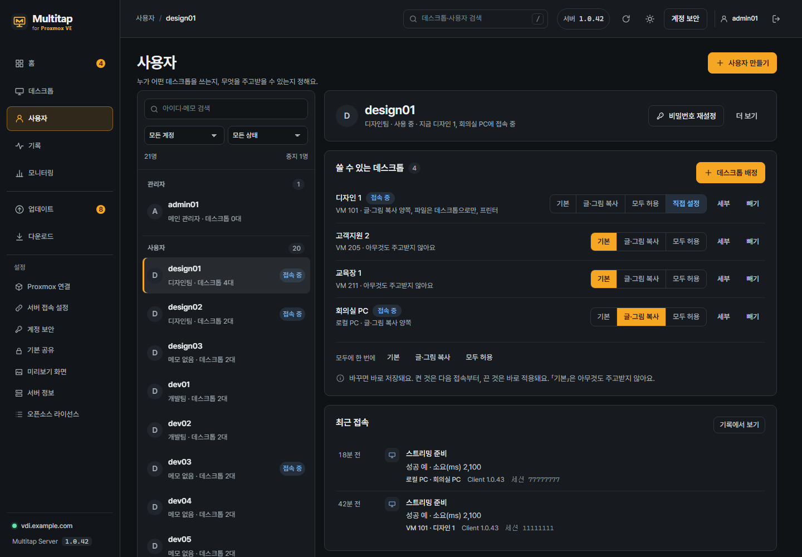
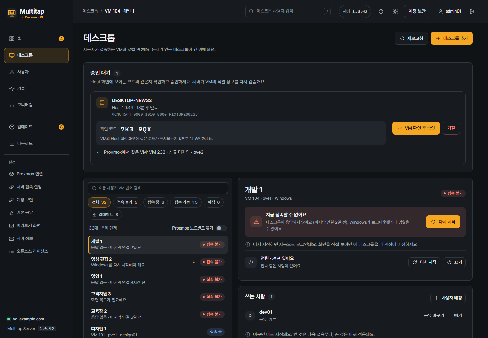
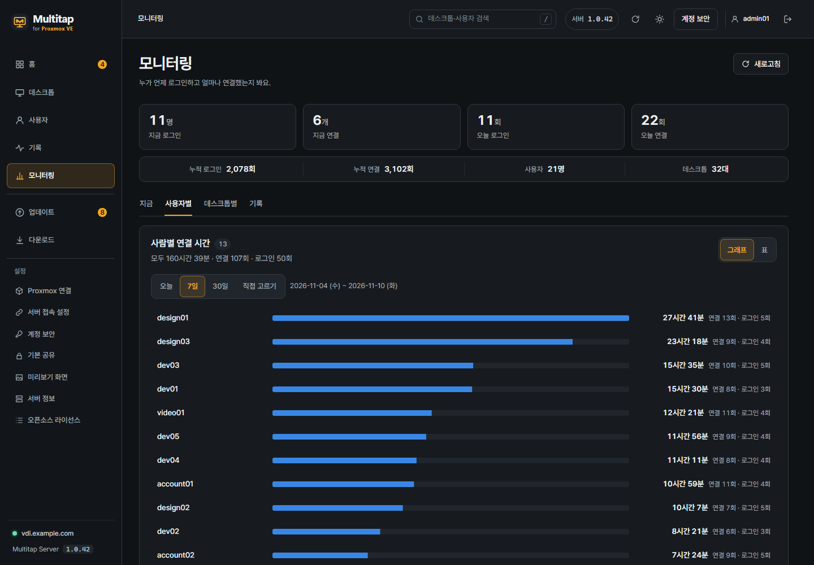

# 5. 사용자와 데스크톱 배정

[목차](README.md) · [이전: Host 설치](04-Host-설치.md) · [다음: Windows 클라이언트](06-Windows-클라이언트.md) · [English](en/05-users-and-desktops.md)

사용자는 관리자가 배정한 데스크톱(VM과 로컬 PC)만 볼 수 있습니다.
배정과 공유는 관리자 페이지의 **사용자**에서 정합니다.

**작업 위치: PC 브라우저의 Multitap 관리자 페이지**

**목표:** 사용자 한 명을 만들고, 그 사용자에게 데스크톱 한 대를 배정합니다.

처음에는 **사용자 만들기 → 데스크톱 배정**까지만 진행해도 됩니다.
복사·USB 같은 공유 기능은 필요한 항목만 나중에 켜세요.

## 관리자 페이지의 메뉴

모든 화면은 왼쪽 메뉴에서 바로 엽니다. 메뉴는 세 묶음이고, 마지막 묶음에는 **설정**이라는 제목이 붙어 있습니다.
휴대폰과 좁은 창에서는 화면 위쪽의 **메뉴** 버튼(줄 세 개)을 누르면 같은 목록이 열립니다.

| 메뉴 | 하는 일 |
| --- | --- |
| **홈** | 지금 할 일과 접속 상태를 봅니다. |
| **데스크톱** | 데스크톱(VM과 로컬 PC)을 추가하고 상태·전원·Host를 관리합니다. |
| **사용자** | 계정을 만들고 데스크톱을 배정하고 공유를 정합니다. |
| **기록** | 접속이 안 됐을 때 원인을 찾습니다. 화질·속도와 관리 작업도 여기에 있습니다. |
| **모니터링** | 누가 언제 로그인하고 얼마나 연결했는지 봅니다. |
| **공지** | 로그인한 사람 모두, 한 사람, 한 데스크톱을 쓰는 사람에게 공지를 보냅니다. |
| **업데이트** | 서버와 Host의 새 버전을 확인하고 적용합니다. 업데이트할 것이 있으면 숫자가 붙습니다. |
| **다운로드** | Windows 클라이언트, Android 앱, Host 설치 파일과 짧은 주소가 있습니다. |
| 설정 › **서버 접속 설정** | 클라이언트와 Host가 접속하는 서버 주소와 포트를 정합니다. |
| 설정 › **Proxmox 연결** | VM 목록과 전원에 쓰는 Proxmox 계정과 토큰을 관리합니다. |
| 설정 › **계정 보안** | 내 관리자 계정의 2단계 인증과 복구 코드를 관리합니다. |
| 설정 › **백업·복원** | 서버 데이터를 백업 파일로 받고, 그 파일로 복원합니다. |
| 설정 › **서버 정보** | 서버 주소·버전·배포 방식과 항상 적용되는 보호 방식을 봅니다. |
| 설정 › **오픈소스 라이선스** | 서버에 포함된 오픈소스 구성요소와 라이선스 원문입니다. |

관리자 계정은 **사용자** 목록의 맨 위 **관리자** 묶음에 모여 있습니다.

### 데스크톱 화면

**데스크톱**에서 데스크톱과 그 Host를 함께 관리합니다.

- 새 Host의 연결 요청은 맨 위 **승인 대기**에 나타납니다.
- 목록은 문제가 있는 데스크톱이 먼저 옵니다.
- 줄을 누르면 상세 창에 원인과 해결 버튼, 전원, **쓰는 사람**, Host 정보가 나옵니다.

## 1단계. 사용자 계정 만들기

1. 관리자 페이지의 **사용자**를 여세요.
2. **사용자 만들기**를 누르세요.
3. **아이디**를 입력하세요.
4. **권한**에서 **일반 사용자**를 선택하세요.
5. 필요하면 **메모 (선택)** 칸에 메모를 입력하세요.
6. **비밀번호**를 10자 이상 입력하세요.
7. **비밀번호 확인**에 같은 비밀번호를 입력하세요.
8. **사용자 만들기**를 누르세요.

새 계정의 화면이 열립니다.
아이디는 공백 없이 2~64자로 입력하며 한글도 사용할 수 있습니다.

**완료 확인:** 사용자 목록에 새 아이디가 보입니다.
이 계정은 Multitap 앱에 로그인할 계정입니다. Host의 Windows 계정과 구분하세요.

> **관리자**는 서버와 다른 사용자도 관리할 수 있습니다.
> 일반 접속용 계정에는 **일반 사용자**를 선택하세요.

## 2단계. 데스크톱 배정

1. 배정할 사용자를 눌러 상세 창을 여세요.
2. **쓸 수 있는 데스크톱**의 **데스크톱 배정**을 누르세요.
3. 사용할 데스크톱을 체크하세요.
4. **배정**을 누르세요.

목록에는 Host를 등록한 데스크톱만 나옵니다.
대상이 많으면 이름이나 VM 번호로 검색할 수 있습니다.

> 누르는 즉시 저장됩니다. 따로 적용할 것이 없습니다.

사용 중지된 계정은 다시 켜야 배정을 바꿀 수 있습니다.

**완료 확인:** **쓸 수 있는 데스크톱**에 배정한 대상이 보입니다.

배정을 없애려면 그 줄의 **빼기**를 누르세요.
그 배정의 공유 설정도 함께 지워지고, 접속 중이면 연결이 끊깁니다.

## 3단계. 공유 정하기

공유는 **사용자 × 데스크톱**마다 따로 저장합니다.
새로 배정한 대상은 아무것도 주고받지 않는 **기본**으로 시작합니다.

**기본**이어도 데스크톱 화면과 키보드·마우스 조작은 사용할 수 있습니다.
첫 연결을 확인하려고 공유를 켤 필요는 없습니다.

배정한 줄에서 하나를 고르세요.

| 선택 | 내용 |
| --- | --- |
| **기본** | 아무것도 주고받지 않습니다. |
| **글·그림 복사** | 글과 그림 복사·붙여넣기를 양쪽으로 허용합니다. |
| **모두 허용** | 복사·붙여넣기와 장치 공유를 모두 허용합니다. |
| **직접 설정** | **세부**에서 항목을 하나씩 켜고 끈 상태입니다. |

고르는 즉시 저장되고 **저장했어요**가 표시됩니다.

### 세부: 복사·붙여넣기

**PC**는 사용자 앞의 컴퓨터, **데스크톱**은 원격으로 쓰는 Windows입니다.

| 항목 | 허용하는 동작 |
| --- | --- |
| **글·그림** · PC → 데스크톱 | PC에서 복사한 글자와 서식을 데스크톱에 붙여넣기 |
| **글·그림** · 데스크톱 → PC | 데스크톱에서 복사한 글자와 서식을 PC에 붙여넣기 |
| **파일** · PC → 데스크톱 | PC의 파일·폴더·이미지를 데스크톱에 붙여넣기 |
| **파일** · 데스크톱 → PC | 데스크톱의 파일·폴더·이미지를 PC에 붙여넣기 |

이미지 붙여넣기에는 해당 방향의 **파일**도 필요합니다.
**글·그림**만 켰는데 이미지가 안 붙으면 **파일**도 켜세요.

파일은 복사할 때 전송하지 않습니다.
사용자가 붙여넣을 때 전송을 시작합니다.

### 세부: 장치

| 항목 | 허용하는 동작 |
| --- | --- |
| **공유 폴더** | 사용자가 선택한 PC 폴더를 데스크톱에서 열기 |
| **프린터** | 데스크톱의 문서를 사용자 쪽 프린터로 인쇄하기 |
| **USB 장치** | 사용자 PC의 USB 장치를 데스크톱에 연결하기 |
| **스마트 카드** | USB 스마트 카드 판독기 사용하기 |
| **직렬(COM) 포트** | USB 직렬 장치 사용하기 |

**스마트 카드**와 **직렬(COM) 포트**는 **드물게 쓰는 것**을 펼치면 나옵니다.

USB 저장장치는 **USB 장치**와 **공유 폴더**를 함께 켜야 합니다.
USB 프린터·스마트 카드·직렬 장치도 **USB 장치**와 해당 항목을 함께 켜야 합니다.

Android에서는 USB 장치를 쓸 수 없습니다([Android 장](07-Android.md)).
Host의 **장치** 화면은 준비 상태를 보여 주며 사용자에게 공유를 허용하지는 않습니다.

### 적용 시점

| 변경 | 적용 방식 |
| --- | --- |
| 복사·붙여넣기 켜기 | 앱이 1.1.13 이상이면 연결 중에도 바로 적용됩니다. 그 전 앱이나 복사·붙여넣기를 모두 끈 채 시작한 연결은 다음 연결부터입니다. |
| 공유 폴더·프린터·USB 켜기 | 다음 연결부터 적용됩니다. |
| 복사·붙여넣기 끄기 | 해당 데스크톱의 진행 중인 연결과 전송이 끝납니다. |
| 공유 폴더·프린터·USB 끄기 | 화면은 그대로 두고 해당 공유만 빠집니다. |

접속 중인 사용자의 공유를 끌 때만 확인 창이 나옵니다.
이미 상대편에 전달된 파일은 공유를 꺼도 지워지지 않습니다.

## 여러 대상에 같은 공유

한 사용자의 모든 데스크톱에 같은 공유가 필요하면 목록 아래 **모두에 한 번에**에서 고르세요.

한 데스크톱을 쓰는 여러 사용자의 공유는 **데스크톱 → 해당 데스크톱 → 쓰는 사람**에서도 바꿀 수 있습니다.
여기에는 **모두에게 한 번에**가 있습니다.

## 사용자에게 전달할 것

| 전달할 정보 | 예시 또는 설명 |
| --- | --- |
| 서버 주소 | `https://vdi.example.com` 또는 운영자가 정한 내부망 HTTP 주소 |
| Multitap 아이디 | 방금 만든 사용자 아이디 |
| 초기 비밀번호 | 별도의 안전한 방법으로 전달 |
| 클라이언트 다운로드 | 서버의 `/get/client` 또는 `/get/android` |

다운로드 주소는 **다운로드**의 **사용자에게 알려 줄 주소**에서 복사할 수 있습니다.

사용자는 클라이언트에서 이 계정으로 로그인합니다.
Host에 저장한 Windows 계정은 [Host 설치 장](04-Host-설치.md#4단계-windows-로그인-계정-저장)에서 관리합니다.

## 처음 연결 확인

1. 사용할 기기에 [Windows 앱](06-Windows-클라이언트.md#처음-연결하는-순서) 또는 [Android 앱](07-Android.md#처음-연결하는-순서)을 설치하세요.
2. 방금 만든 **일반 사용자 계정**으로 로그인하세요.
3. 배정한 데스크톱 카드가 보이는지 확인하세요.
4. 그 카드의 **스트리밍 연결**을 누르세요.
5. 데스크톱 화면에서 마우스와 글자 입력을 확인하세요.

목록이 비어 있다면 관리자 페이지의 **사용자**에서 그 사용자의 **쓸 수 있는 데스크톱**을 다시 확인하세요.
카드는 보이지만 연결되지 않으면 카드에 표시된 오류로 [문제 해결](09-문제-해결.md#어디까지-됐는지부터-확인하세요)을 찾으세요.
관리자 페이지의 **기록 → 문제 찾기**에는 접속 실패마다 원인과 해결 방법이 나옵니다.

## 누가 얼마나 썼는지 보기 (모니터링)

관리자 페이지의 **모니터링**에서 봅니다.

| 보기 | 내용 |
| --- | --- |
| **지금** | 지금 연결한 사람과 로그인한 사람, 클라이언트 종류·버전, 접속한 주소, 시작한 시각 |
| **사용자별** | 기간(오늘·7일·30일·직접 고르기) 동안 사람마다 연결한 시간을 막대로 비교합니다. 이름을 누르면 날짜별 시간과 연결 목록이 나옵니다. |
| **데스크톱별** | 데스크톱마다 쓰인 시간과 쓴 사람을 봅니다. |
| **기록** | 하루의 로그인과 연결을 사람별로 보고, 이름·주소·데스크톱으로 찾습니다. |

**그래프**와 **표**는 같은 숫자를 보여 줍니다.

> **연결 시간**은 데스크톱에 연결해 있던 시간입니다. 자리를 비운 시간도 들어 있어서 일한 시간과 같지 않습니다.

로그인·연결 기록은 2년 동안 서버에 보관합니다. 기록에는 접속한 곳의 IP 주소가 들어 있습니다.
계정을 삭제하면 그 계정의 기록도 함께 지워집니다.
하루는 서버의 시간대 기준이고, 화면 아래에 시간대가 적혀 있습니다.
**추정**이라고 표시된 연결은 끝난 시각을 서버가 추정한 것입니다(클라이언트가 말없이 사라졌거나 서버가 꺼졌을 때).

## 계정 중지와 비밀번호 재설정

**비밀번호 재설정**은 사용자 화면 위쪽에, **계정 중지**와 **삭제**는 **더 보기** 안에 있습니다.

**계정 중지**는 기존 로그인을 해제하지만 배정과 공유는 유지합니다.
비밀번호를 잊은 경우 **비밀번호 재설정**으로 새 비밀번호를 정하세요.

비밀번호 재설정·권한 변경·삭제 시 해당 계정의 기존 로그인이 해제됩니다.
최초의 **메인 관리자**는 강등·중지·삭제할 수 없습니다.

## VM을 옮기거나 복원할 때

Proxmox에서 VM을 다른 노드로 옮기거나(마이그레이션, HA), 백업을 새 VM ID로 복원해도 데스크톱은 그 VM을 따라갑니다.
배정, 공유, Host 등록은 그대로입니다. 다시 승인하거나 배정할 필요가 없습니다.

서버는 Host를 승인할 때 기록한 VM의 고유 ID로 VM을 찾습니다.
같은 고유 ID의 VM이 여럿이면 따라가지 않습니다.
따라간 기록은 **기록 → 관리 작업**에 **데스크톱 VM 위치 변경**으로 남고, 옮기기 전과 뒤의 노드와 VM 번호가 함께 나옵니다.

## 데스크톱 삭제

**데스크톱**에서 지울 데스크톱을 체크하고 **선택 삭제**를 누르거나, 상세 창의 **삭제**를 누릅니다.
확인 칸에 데스크톱 이름(여러 대면 '삭제')을 입력합니다.
배정과 권한도 함께 지워지고, VM·파일·사용자 계정은 그대로입니다.
