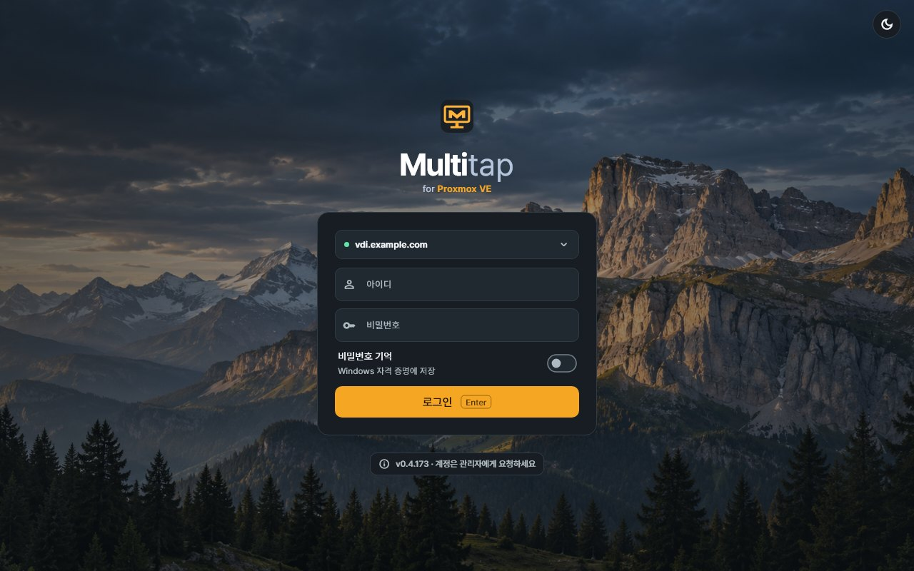
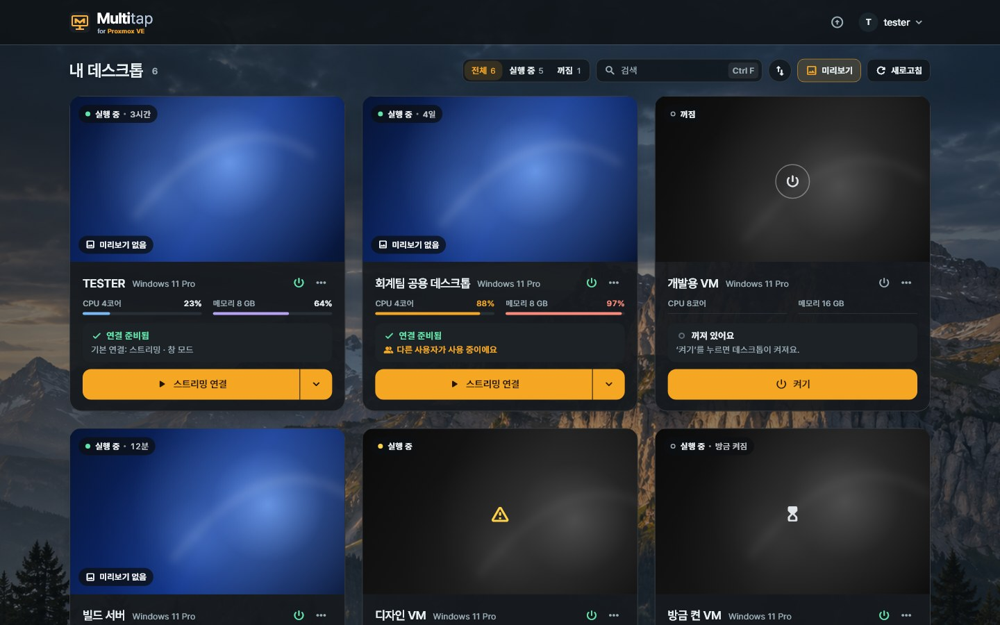
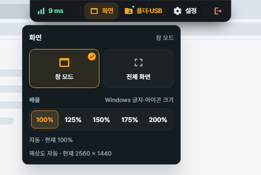
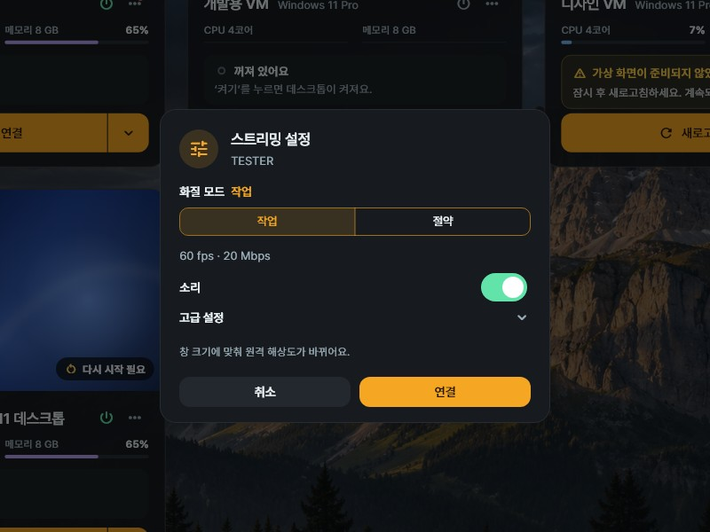

# 6. Windows 클라이언트

[가이드북 목차](README.md) · [이전: 사용자와 데스크톱 배정](05-사용자와-VM-배정.md) · [다음: Android](07-Android.md) · [English](en/06-windows-client.md)

Windows 클라이언트는 PC에서 배정받은 데스크톱에 연결하는 앱입니다.
**데스크톱**은 원격으로 쓰는 Windows(Proxmox VM 또는 로컬 PC)이고, **PC**는 지금 앞에 있는 컴퓨터입니다.
데스크톱에는 Host가 설치되어 있어야 합니다.

## 처음 연결하는 순서

**작업 위치: 지금 사용할 Windows PC**

관리자에게 **서버 주소·Multitap 아이디·비밀번호**를 먼저 받으세요.

| 순서 | 할 일 | 완료 확인 |
| --- | --- | --- |
| 1 | [앱 설치](#설치와-로그인) | PC에서 Multitap 클라이언트가 열림 |
| 2 | [서버 주소 테스트·저장](#서버-주소-저장) | 연결 확인 후 주소가 저장됨 |
| 3 | [계정으로 로그인](#계정으로-로그인) | **내 데스크톱**에 배정된 데스크톱이 보임 |
| 4 | [스트리밍 연결](#스트리밍-연결) | 별도 창에 데스크톱 화면이 보임 |

처음에는 화질·배율·USB 설정을 바꾸지 않고 연결해 보세요.
화면이 나온 뒤 필요한 기능을 하나씩 사용하면 됩니다.

## 설치와 로그인

1. 관리자가 알려 준 `https://vdi.example.com/get/client`를 엽니다.
2. 받은 설치 파일을 실행하고 Windows의 관리자 권한 요청을 승인합니다.
3. 설치를 마친 뒤 Multitap을 실행합니다.

예시의 `vdi.example.com`을 관리자가 알려 준 실제 서버 주소로 바꾸세요.
HTTP 서버라면 `http://서버IP:18480/get/client`에서 받습니다.

Windows가 **Windows의 PC 보호**나 **알 수 없는 게시자** 경고를 보일 수 있습니다. 설치 파일에 구매한 코드 서명 인증서가 없기 때문입니다([문제 해결](09-문제-해결.md#defendersmartscreen이-설치를-막음)).

앱은 관리자 권한 없이 실행합니다.
설치·업데이트·USB 드라이버 설치 때만 Windows가 관리자 승인을 묻습니다.
창의 X를 누르면 앱이 트레이로 숨습니다. 완전히 끝내려면 계정 메뉴의 **완전 종료**를 누르세요.

### 서버 주소 저장

1. 로그인 화면의 **서버 설정 필요**를 누릅니다.
2. **HTTPS** 또는 관리자가 안내한 **HTTP**를 선택합니다.
3. **서버 주소**에 `https://vdi.example.com`을 입력합니다.
4. **연결 테스트**를 누릅니다.
5. **연결이 확인됐어요**가 표시되면 **저장**을 누릅니다.

이미 주소가 있으면 로그인 화면 위쪽의 서버 주소를 눌러 바꿉니다.
주소나 연결 방식을 바꾸면 **연결 테스트**를 다시 해야 합니다.

주소에는 맨 앞의 `https://` 또는 `http://`와 필요한 포트까지 넣으세요.
브라우저의 `/admin/` 같은 뒤쪽 경로는 빼고 **서버 주소 부분만** 사용하세요.

> **HTTP 주의:** 로그인 정보·화면·입력이 암호화되지 않습니다. 믿을 수 있는 내부 네트워크에서만 사용하세요.

HTTP를 쓸 때는 관리자가 안내한 포트까지 입력합니다. 예: `http://vdi.example.com:18480`.
경고 내용을 확인한 뒤 **이 주소에 HTTP 사용**을 누릅니다.

### 계정으로 로그인

1. 관리자가 만든 **아이디**를 입력합니다.
2. **비밀번호**를 입력합니다.
3. PC에 비밀번호를 저장하려면 **비밀번호 기억**을 켭니다.
4. **로그인**을 누릅니다.

아이디는 서버별로 기억합니다.
비밀번호는 지금 Windows 사용자의 자격 증명에 저장합니다. 공용 PC에서는 **비밀번호 기억**을 끄세요.
저장한 비밀번호는 로그아웃한 뒤에도 로그인 화면에 채워집니다.

2단계 인증을 쓰는 계정은 인증 앱의 6자리 코드나 복구 코드를 한 번 더 묻습니다.

**완료 확인:** 로그인 화면 대신 **내 데스크톱** 목록이 나옵니다.
비밀번호가 맞지 않으면 관리자에게 계정을, 목록이 비어 있으면 데스크톱 배정을 요청하세요.

## 내 데스크톱 찾기

로그인하면 배정받은 데스크톱만 카드로 보입니다.

| 화면 요소 | 사용하는 방법 |
| --- | --- |
| **구분** | **전체**, **VM**, **로컬 PC**로 고릅니다. 두 종류를 모두 배정받았을 때 보입니다. |
| **상태** | **전체**, **실행 중**, **꺼짐**으로 고릅니다. |
| 검색 | 이름·번호·분류로 찾습니다. `Ctrl+F`로 검색을 열 수 있습니다. |
| **미리보기** | 카드의 화면 그림을 켜거나 끕니다. |
| **새로고침** | 목록과 연결 준비 상태를 다시 확인합니다. |
| **▾** | 연결 방식(**창 모드**, **전체 화면**, **모든 모니터**), **스트리밍 설정…**, **Console**을 엽니다. |
| **⋯** | 즐겨찾기, **연결 준비 점검**, Host 업데이트를 엽니다. 가능한 항목은 데스크톱마다 다릅니다. |
| **⏻** | 권한이 있는 전원 작업을 엽니다. |

카드는 창 너비에 맞춰 자동으로 배치됩니다.

미리보기는 최근 화면이며 지금 화면과 다를 수 있습니다.
화면 잠금·Windows 로그인 화면은 미리보기로 찍지 않습니다.

### 전원 켜기·끄기

1. 카드의 **⏻**를 누릅니다.
2. 필요한 작업을 선택합니다.
3. 확인창에서 대상과 영향을 확인하고 실행합니다.

| 작업 | 동작 |
| --- | --- |
| **켜기** | 데스크톱을 켭니다. 로컬 PC는 Wake-on-LAN이 준비된 경우에 켤 수 있습니다. |
| **종료** | Windows에 정상 종료를 요청합니다. |
| **다시 시작** | Windows를 다시 시작합니다. 연결은 끊깁니다. |
| **정지** | VM 전원을 바로 끊습니다. 로컬 PC에는 없습니다. |

> **정지 주의:** 저장하지 않은 작업이 사라질 수 있습니다. Windows가 응답하지 않을 때만 사용하세요.

꺼진 카드에서는 그림 가운데의 전원 표시와 아래의 **켜기** 버튼이 같은 일을 합니다.
전원 작업이 비활성화되어 있으면 표시된 이유를 확인하세요.

## 스트리밍 연결

카드가 **꺼짐**이면 **켜기**로 먼저 켜세요. 켜진 뒤에 연결할 수 있습니다.
준비 오류가 보이면 그 문구를 먼저 확인하세요([문제 해결](09-문제-해결.md#어디까지-됐는지부터-확인하세요)).

1. 카드의 **스트리밍 연결**을 누릅니다. 카드 그림의 **▶**도 같습니다.
2. **"<이름>에 연결할까요?"** 확인창에서 대상과 연결 방식을 확인합니다.
3. **연결**을 누릅니다.
4. 화면이 나타나면 화면 안을 클릭합니다.

연결은 **연결 버튼과 ▶**로만 시작합니다. 카드 본문을 누르거나 키보드의 Enter를 눌러서는 연결되지 않습니다.
확인창은 모든 새 연결 전에 나오고, **취소**하면 아무 요청도 보내지 않습니다.
좁은 창에서는 버튼이 **연결**로 짧게 표시됩니다.

데스크톱 화면은 별도 창에 열리고 목록은 남아 있습니다.
창을 닫으면 **연결을 끊을까요?**를 묻습니다. 연결만 끊고 데스크톱의 전원과 작업은 그대로 둡니다.

### 다른 사람이 쓰고 있을 때

내게 배정된 데스크톱이면 **다른 곳에서 연결 중이에요** 안내에 연결 중인 계정과 시작 시각이 나옵니다.
확인한 뒤 **끊고 여기서 연결**을 누르면 바로 상대 연결이 끊기고 내가 연결됩니다.
데스크톱과 실행 중인 작업은 그대로입니다.

### 첫 화면이 나오면 해볼 것

1. 데스크톱의 시작 메뉴를 여세요.
2. **메모장**을 실행하세요.
3. 짧은 글자를 입력하세요.
4. 메모장 창의 제목 부분을 끌어 이동해 보세요.

**완료 확인:** 글자가 메모장에 써지고, 끈 창이 따라 움직입니다.
한글이 필요하면 화면을 클릭한 뒤 **한/영** 키도 확인하세요.

이제 기본 연결은 끝났습니다.
글자 크기는 [배율](#해상도와-배율), 파일 복사는 [복사·붙여넣기](#복사붙여넣기), 끝낼 때는 툴바의 **연결 끊기**를 사용하세요.

### Windows 키와 한/영 키

화면 안을 클릭해 입력을 넘긴 동안에는 Windows 키와 `Alt+Tab` 등을 데스크톱으로 보냅니다.
키보드의 **한/영** 키도 데스크톱의 입력 언어를 바꿉니다.

1. PC로 키보드 입력을 돌리려면 `Ctrl+Alt+Shift+F12`를 누릅니다.
2. 데스크톱으로 다시 보내려면 화면 안을 클릭합니다.

툴바를 열거나 다른 창으로 이동해도 입력을 돌려받습니다.
`Ctrl+Alt+Del`은 스트리밍으로 보낼 수 없습니다. 작업 관리자는 `Ctrl+Shift+Esc`로 엽니다.

## 세션 툴바

툴바는 데스크톱 창 위쪽 가운데의 작은 손잡이를 누르면 열립니다.
손잡이에는 지연 시간이 보입니다. 항목은 다섯 개입니다.

| 항목 | 하는 일 |
| --- | --- |
| **연결 품질** (지연 시간 표시) | 왕복 지연, 화면 프레임, 받은 영상량, 영상 경로(UDP/TCP)를 봅니다. **연결 통계 보기**도 여기에 있습니다. |
| **화면** | **창 모드**, **전체 화면**, **모든 모니터**를 고르고, 같은 패널에서 **배율**을 바꿉니다. |
| **폴더·USB** | **공유 폴더**와 **USB 장치** 탭이 있습니다. 허용된 것만 보입니다. |
| **설정** | **화질**, **마우스 잠금**, **사용안내**, **툴바 열어 두기**가 있습니다. |
| **연결 끊기** | 지금 연결을 끝냅니다. 데스크톱의 전원과 작업은 그대로입니다. |

항목을 쓰거나 데스크톱 화면을 누르면 툴바가 접힙니다. `Esc`로도 접습니다.
계속 열어 두려면 **설정**의 **툴바 열어 두기**를 켜세요.
전체 화면에서는 창 제목 줄이 없으므로 툴바에 **최소화**와 **창 모드로** 버튼이 함께 나옵니다.
창이 좁으면 가운데 항목들이 **메뉴** 하나로 묶입니다.

회색으로 보이는 항목은 마우스를 올리면 이유가 나옵니다.

### 해상도와 배율

해상도는 데스크톱 창의 크기에 자동으로 맞춥니다.
해상도를 바꾸려면 창의 크기를 조절하세요.

1. 툴바의 **화면**을 누릅니다.
2. **배율**에서 **100%**, **125%**, **150%**, **175%**, **200%** 중 하나를 고릅니다.
3. 패널 아래의 현재 배율과 해상도 표시를 확인합니다.

배율은 Windows의 글자와 아이콘 크기를 바꿉니다. 새 연결은 100%로 시작합니다.
Windows가 허용하는 배율은 화면 크기에 따라 달라질 수 있습니다.

### 두 모니터 사용

1. PC에 모니터 두 대를 연결합니다.
2. 툴바의 **화면**을 누릅니다.
3. **모든 모니터**를 선택합니다.

PC에 모니터가 정확히 두 대 있고 Host가 지원해야 합니다.
두 모니터에는 서로 다른 화면이 나옵니다. 툴바와 패널은 주 모니터에 표시됩니다.

스트리밍은 Host의 Multitap 가상 화면을 사용합니다.
연결 중에는 데스크톱의 다른 화면이 꺼지고, 연결이 끝나면 원래 화면 구성으로 돌아갑니다.

### 화질

1. 툴바의 **설정**에서 **화질**을 엽니다.
2. **화질 모드**를 고르거나 **고급 설정**에서 **목표 프레임**, **영상 전송률**, **하드웨어 디코딩**을 바꿉니다.
3. **다시 연결**을 눌러 적용합니다.

새 연결의 기본값은 **60 fps**, 전송률 **자동 (권장)**입니다. 직접 저장한 설정이 있으면 그 값을 씁니다.
자동 전송률은 연결 상태에 맞춰 조절합니다. 지금 받는 양은 **연결 품질**에서 봅니다.
화면이 깨질 때는 **하드웨어 디코딩**을 끄고 다시 확인해 보세요.

### 소리

데스크톱의 소리는 항상 PC 스피커로 함께 나옵니다. 크기는 PC의 볼륨으로 조절합니다.
카드에 **소리 없음**이 보이면 데스크톱에 소리 장치가 없는 것입니다.
관리자에게 Proxmox에서 VM에 오디오 장치를 추가해 달라고 요청하세요. 앱에서는 추가하지 않습니다.

### 마우스 잠금

게임처럼 마우스의 상대 움직임이 필요한 프로그램에서 씁니다.
평소에는 꺼 둔 채로 사용하세요.

1. 툴바의 **설정**에서 **마우스 잠금**을 누르거나 `Ctrl+Shift+Alt+Z`를 누릅니다.
2. 풀 때도 `Ctrl+Shift+Alt+Z`를 누릅니다.

모든 새 연결은 마우스 잠금이 꺼진 상태로 시작합니다.
잠금 중에는 사용할 수 있으면 가상 USB 마우스를 연결하고, 안 되면 일반 입력으로 동작합니다.
일반 입력에서는 일부 게임이 마우스를 받지 않을 수 있습니다.
이때는 관리자에게 USB 공유 권한과 Host의 USB 상태를 확인해 달라고 요청하세요.

## 복사와 장치 공유

무엇을 주고받을 수 있는지는 관리자가 사용자와 데스크톱마다 정합니다.
새 배정은 아무것도 주고받지 않는 **기본**으로 시작합니다.
먼저 툴바 **설정**의 **사용안내**에서 지금 연결에 허용된 기능을 확인하세요.

### 복사·붙여넣기

1. 원본 파일이나 글자를 선택합니다.
2. `Ctrl+C`로 복사합니다.
3. 대상 쪽의 폴더나 입력 칸을 엽니다.
4. `Ctrl+V`로 붙여넣습니다.

글·그림과 파일은 방향마다(PC → 데스크톱, 데스크톱 → PC) 따로 허용됩니다.
파일은 복사할 때가 아니라 붙여넣을 때 전송합니다.
이미지 붙여넣기에는 그 방향의 파일 권한도 필요합니다.

처음 확인할 때는 짧은 글자부터 복사해 보세요.
파일이 안 붙으면 **사용안내**에서 파일 권한과 방향을 확인하세요.

### 공유 폴더

1. 툴바의 **폴더·USB**에서 **공유 폴더** 탭을 엽니다.
2. **폴더 추가…**를 눌러 PC에서 공유할 폴더를 고릅니다.
3. 확인창에서 **공유**를 누릅니다.
4. **열기**를 눌러 데스크톱의 탐색기에서 확인합니다.

폴더는 데스크톱에 드라이브로 붙습니다.
데스크톱의 프로그램이 폴더의 파일을 읽고 바꿀 수 있으니 필요한 폴더만 고르세요.
연결을 끊으면 공유도 끝납니다.

### 프린터

1. 데스크톱에서 인쇄창을 엽니다.
2. **Multitap 프린터**를 선택하고 인쇄합니다.
3. PC에 뜬 미리보기를 확인합니다.
4. 프린터와 매수를 고르고 **인쇄**를 누릅니다.

파일로 보관하려면 **PDF로 저장**을 누릅니다.

### USB 장치

1. 툴바의 **폴더·USB**에서 **USB 장치** 탭을 엽니다.
2. 드라이버 안내가 있으면 **USB 드라이버 설치…**를 누르고 Windows의 관리자 승인을 확인합니다.
3. 연결할 장치의 **연결**을 누릅니다.
4. 데스크톱에서 장치를 사용합니다.
5. 사용을 마치면 장치의 **연결 끊기**를 누릅니다.

연결 중에는 그 장치를 PC에서 쓸 수 없습니다.
저장 장치는 데스크톱에서 **하드웨어 안전하게 제거**를 한 뒤 연결을 끊으세요.

PC에 꽂힌 장치의 정보를 읽지 못하면 탭에 **장치 정보를 읽지 못한 USB 장치가 N개 있어요.** 줄이 나옵니다.
그 장치를 PC에서 뺐다가 다시 꽂아 보세요.

## Console — 로그아웃되거나 잠겼을 때

Windows가 로그아웃되거나 잠겨 있으면 스트리밍으로 연결할 수 없습니다. 로그인 화면은 스트리밍하지 않습니다.
이때는 Console을 쓰거나 다시 시작하세요.

- **Console:** Proxmox VM의 기본 화면을 앱 안에서 엽니다. 여기에서 Windows에 로그인하거나 잠금을 풉니다.
- **다시 시작:** 카드의 **⏻ → 다시 시작**. Host에 Windows 계정이 저장돼 있으면 자동으로 로그인됩니다.

1. 카드의 **▾**를 누릅니다.
2. **Console**을 선택합니다.
3. 확인창의 **Console로 열기**를 누릅니다.

같은 로그인으로 연결하므로 아이디·비밀번호를 다시 입력하지 않습니다.
Console은 Host가 꺼져 있어도 열립니다. 로컬 PC에는 없습니다.
Windows에서 WebView2 설치 안내가 나오면 안내에 따라 설치한 뒤 다시 여세요.

Console 도구는 화면 위쪽 가운데의 작은 손잡이에 달려 있습니다.
손잡이를 누르면 **Ctrl+Alt+Del 보내기**, **텍스트 클립보드**, **전체 화면**, **도움말**이 나옵니다.
텍스트 클립보드는 관리자가 허용한 방향으로만 쓸 수 있고, 한글 같은 문자는 보내지 않습니다.

Console을 여는 동안에는 VM의 기본(Proxmox) 화면 하나만 켜집니다. Console을 닫으면 다른 화면이 돌아옵니다.
**콘솔에 보일 화면이 없어요**가 나오면 관리자에게 알려 주세요. [문제 해결](09-문제-해결.md#console이-열리지-않거나-검게-보임)에 할 일이 있습니다.

## 설정

목록 화면 위쪽의 **⚙**(설정)에서 앱 설정을 바꿉니다.

| 항목 | 하는 일 |
| --- | --- |
| **언어** | **자동**, **한국어**, **English** 중에서 고릅니다. **자동**은 Windows 언어를 따릅니다. |
| **자동 로그아웃** | 이번 로그인에서 자동 로그아웃을 켜거나 끕니다. |
| **2단계 인증** | 로그인할 때 인증 앱의 코드도 확인하도록 설정합니다. |
| **비밀번호 변경** | Multitap 로그인 비밀번호를 바꿉니다. |

### 자동 로그아웃

키보드·마우스·게임패드 입력이 없으면 30분 뒤 자동으로 로그아웃되고 연결도 끊깁니다.
1분 전에 경고가 나오며 **계속 사용**을 누르면 유지됩니다.
**⚙** 설정의 **자동 로그아웃** 스위치로 이번 로그인에서만 끌 수 있습니다.

[가이드북 목차](README.md)
