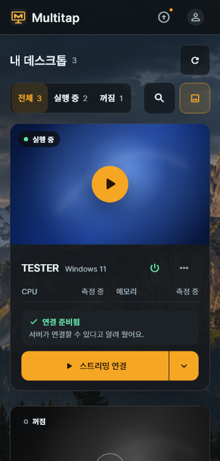
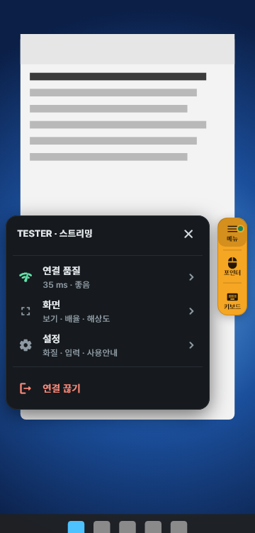

# 7. Android 클라이언트

[가이드북 목차](README.md) · [이전: Windows 클라이언트](06-Windows-클라이언트.md) · [다음: 업데이트](08-업데이트.md) · [English](en/07-android.md)

Android 클라이언트로 배정받은 데스크톱(Proxmox VM 또는 로컬 PC)에 연결합니다.
이 장은 휴대폰·태블릿의 터치 화면을 기준으로 설명합니다.

> Android에서는 USB 장치를 연결할 수 없습니다. USB 장치는 Windows 클라이언트에서 사용하세요.

## 처음 연결하는 순서

**작업 위치: 사용할 Android 휴대폰·태블릿**

관리자에게 **서버 주소·Multitap 아이디·비밀번호**를 먼저 받으세요.

1. [앱 설치와 로그인](#설치와-로그인)을 진행하세요.
2. [배정된 데스크톱의 스트리밍 연결](#데스크톱-선택과-연결)을 누르세요.
3. [앰버색 버튼의 키보드](#앰버색-버튼-세-개)를 눌러 글자를 입력해 보세요.

**완료 확인:** 앱 안에 데스크톱 화면이 보이고, 터치와 글자 입력이 됩니다.
처음에는 기본 **포인터** 방식으로 사용하고, 익숙해지면 **터치**로 바꿔 보세요.

## 설치와 로그인

1. Android 기기에서 관리자가 알려 준 `https://vdi.example.com/get/android`를 엽니다.
2. 내려받은 APK를 설치합니다.
3. Multitap 앱을 실행합니다.
4. 로그인 화면의 **서버 설정 필요**를 누릅니다.
5. **HTTPS** 또는 관리자가 안내한 **HTTP**를 선택합니다.
6. **서버 주소**에 `https://vdi.example.com`을 입력합니다.
7. **연결 테스트**를 누릅니다.
8. 연결이 확인되면 **저장**을 누릅니다.
9. 관리자가 만든 **아이디**를 입력합니다.
10. **비밀번호**를 입력합니다.
11. 필요하면 **비밀번호 기억**을 켭니다.
12. **로그인**을 누릅니다.

서버를 바꾸려면 로그인 화면 위쪽의 주소를 누릅니다.
주소나 연결 방식을 바꾸면 테스트를 다시 해야 합니다.
APK 설치가 막히면 Android의 설치 출처 허용 안내를 확인하세요.

APK는 Android 앱 설치 파일입니다.
관리자가 안내한 서버에서 받은 파일인지 확인한 뒤 설치하세요.
Android 8.0 이상에서 쓸 수 있습니다.

예시의 `vdi.example.com`은 실제 서버 주소로 바꾸세요.
HTTP 서버라면 `http://서버IP:18480/get/android`에서 받습니다.

> **HTTP 주의:** 로그인 정보·화면·입력이 암호화되지 않습니다. 믿을 수 있는 내부 네트워크에서만 사용하세요.

HTTP는 관리자가 안내한 포트까지 입력합니다. 예: `http://vdi.example.com:18480`.
경고를 확인한 뒤 **이 주소에 HTTP 사용**을 누릅니다.

## 데스크톱 선택과 연결

Windows와 같은 카드 디자인을 사용합니다.
화면 너비에 맞춰 카드 열 수가 자동으로 바뀝니다.

1. **구분**에서 **VM** 또는 **로컬 PC**를 고릅니다.
2. **상태**에서 필요한 전원 상태를 고릅니다.
3. 검색으로 이름·번호·분류를 찾습니다.
4. 사용할 카드의 **스트리밍 연결**을 누릅니다.
5. 연결 확인창의 대상을 확인합니다.
6. **연결**을 누릅니다.

**구분**은 VM과 로컬 PC를 모두 배정받았을 때 보입니다.
좁은 화면에서는 연결 버튼이 **연결**로 표시됩니다.
카드의 다른 부분을 누르는 것만으로는 연결되지 않습니다.
확인창에서 **취소**하면 아무 요청도 보내지 않습니다.

**미리보기**는 최근 화면 그림을 켜거나 끕니다.
작은 화면에서는 글자 대신 미리보기 아이콘으로 표시됩니다.

카드의 **⏻**에서 허용된 전원 작업(**켜기**, **종료**, **다시 시작**, **정지**)을 선택합니다.
**▾**에는 **스트리밍 설정…**과 **Console**이, **⋯**에는 Host 업데이트 등이 있습니다.
VM을 **정지**하면 저장하지 않은 작업이 사라질 수 있습니다.

데스크톱의 소리는 항상 함께 나옵니다. 크기는 기기의 볼륨으로 조절합니다.
해상도는 기기 화면에 맞춰 자동으로 정합니다.

**완료 확인:** 연결한 뒤 앱 안에 데스크톱 화면이 나옵니다.
목록이 비어 있으면 관리자에게 데스크톱 배정을 요청하고, 준비 오류가 보이면 카드의 안내를 따르세요.

## 앰버색 버튼 세 개

데스크톱 화면에는 작은 앰버색(노란색) 버튼 묶음이 떠 있습니다.
위에서부터 **메뉴**, **입력 방식**, **키보드** 순서입니다.

| 버튼 | 한 번 누르면 |
| --- | --- |
| **메뉴** | 버튼 옆에 세션 메뉴가 열립니다. |
| **입력 방식** | **포인터**와 **터치**를 바꿉니다. 버튼은 지금 방식을 표시합니다. |
| **키보드** | 화면 키보드를 열거나 닫습니다. |

버튼 묶음을 끌면 원하는 위치로 옮길 수 있습니다.
놓으면 화면 가장자리에 붙고, 잠시 사용하지 않으면 흐려집니다.
**입력 방식**과 **키보드**는 메뉴를 열지 않고 바로 사용할 수 있습니다.

### 세션 메뉴

**메뉴**를 누르면 Windows 세션 툴바와 같은 내용이 줄로 나옵니다.
줄을 누르면 같은 자리에 그 패널이 열리고, 위쪽의 **뒤로**로 돌아옵니다.

| 줄 | 안에 있는 것 |
| --- | --- |
| **연결 품질** | 왕복 지연, 화면 프레임, 받은 영상량, 해상도, 영상 경로. **연결 통계 보기**에는 Host 처리와 **이 기기 처리**(디코딩에 걸린 시간 등)가 나옵니다. |
| **화면** | **전체 보기**와 **화면 이동**, Windows **배율**(100~200% 다섯 단계), **해상도**(**자동 (권장)** 또는 **기기에 맞춤**) |
| **공유 폴더** | 이 기기의 폴더를 데스크톱에 연결합니다. 허용된 연결에서만 보입니다. [공유 폴더](#공유-폴더) 참고. |
| **설정** | **화질**, **마우스 잠금**, **입력 방식**(포인터 속도 포함), **사용안내** |
| **연결 끊기** | 연결을 끝냅니다. |

Android 메뉴에는 **공유 폴더**가 있고, USB 장치는 없습니다.

### 화면과 화질

데스크톱의 해상도는 기기 화면에 맞춰 자동으로 조절합니다.
두 손가락으로 벌리면 이 기기에 보이는 그림만 확대합니다.
**배율**은 Windows의 글자와 아이콘 크기를 바꿉니다.

1. **메뉴 → 설정 → 화질**을 엽니다.
2. 화질 모드나 프레임·전송률을 고릅니다.
3. **다시 연결**을 누릅니다.

처음 연결하는 데스크톱의 기본값은 **60 fps**와 **자동** 전송률입니다.
저장한 설정이 있으면 그 값을 사용합니다.
실제 받은 영상의 프레임과 전송률은 **연결 품질**에서 확인하세요.

## 포인터와 터치

**포인터**는 노트북 트랙패드처럼 커서를 움직이는 방식입니다.
처음 사용할 때의 기본 입력 방식입니다.
**터치**는 화면에서 누른 위치를 직접 조작하는 방식입니다.

1. 가운데 **입력 방식** 버튼을 눌러 방식을 바꿉니다.
2. 포인터 속도를 바꾸려면 같은 버튼을 길게 누릅니다.

### 포인터: 트랙패드처럼 쓰기

화면의 빈 곳을 손가락으로 밀면 커서가 움직입니다.
커서를 버튼 위로 옮긴 뒤 한 번 탭하면 클릭합니다.

| 손동작 | 결과 |
| --- | --- |
| 한 손가락으로 밀기 | 커서를 이동합니다. |
| 한 번 탭 | 커서 위치를 클릭합니다. |
| 두 번 탭 | 커서 위치를 더블 클릭합니다. |
| 두 번 탭하고 두 번째를 누른 채 이동 | 파일·창을 끌거나 범위를 선택합니다. |
| 두 손가락으로 위아래 이동 | 스크롤합니다. |
| 길게 누르기 또는 두 손가락 탭 | 오른쪽 클릭합니다. |

### 터치: 누른 곳 조작하기

| 손동작 | 결과 |
| --- | --- |
| 한 번 탭 | 누른 곳을 조작합니다. |
| 두 번 탭 | 누른 곳을 더블 클릭합니다. |
| 한 손가락으로 위아래 이동 | 스크롤합니다. |
| 두 번 탭하고 두 번째를 누른 채 이동 | 누른 곳에서 끌기를 시작합니다. |
| 길게 누르기 또는 두 손가락 탭 | 오른쪽 클릭합니다. |

Host가 Windows 터치 입력을 지원하면 실제 터치로 전달합니다.
지원하지 않는 연결에서는 마우스 입력으로 조작합니다.
동작이 다른 프로그램에서는 **포인터** 방식으로 바꿔 보세요.
한 번 탭은 두 번 탭인지 구분하느라 클릭이 조금 늦게 전달될 수 있습니다.

### 두 방식의 공통 동작

| 손동작 | 결과 |
| --- | --- |
| 두 손가락 벌리기·오므리기 | 그림을 확대하거나 전체 보기까지 줄입니다. |
| 세 손가락 탭 | 키보드를 열거나 닫습니다. |
| 네 손가락 탭 | **포인터**와 **터치**를 바꿉니다. |

터치한 곳에는 표시가 나타납니다.
길게 누를 때는 원형 진행 표시가 나오고, 오른쪽 클릭이 되면 진동으로 알려 줍니다.
진동은 기기의 지원과 설정에 따라 느껴지지 않을 수 있습니다.

## 키보드와 PC 키 줄

1. 버튼 묶음 맨 아래의 **키보드**를 누릅니다.
2. 데스크톱의 입력 칸을 선택합니다.
3. Android 키보드로 입력합니다.
4. 입력을 마치면 **키보드**를 다시 누릅니다.

키보드 위에는 PC 키 줄이 표시됩니다.
옆으로 밀면 나머지 키를 볼 수 있습니다.

처음 확인할 때는 데스크톱에서 **메모장**을 열어 짧은 글자를 써 보세요.
입력 칸을 선택했는지 확인하면 다른 창에 글자가 들어가는 실수를 줄일 수 있습니다.

| 키 | 사용하는 방법 |
| --- | --- |
| **Ctrl**, **Alt**, **Shift** | 한 번 누른 뒤 다음 키를 입력하면 조합키로 보냅니다. |
| 수정키 길게 누르기 | 키를 고정합니다. 같은 키를 다시 누르면 해제합니다. |
| Windows 아이콘 | 데스크톱의 시작 메뉴를 엽니다. |
| **한/영** | 데스크톱의 한글·영문 입력 상태를 바꿉니다. |
| **Esc**, **Tab**, 방향키, **Del** | 해당 PC 키를 데스크톱으로 보냅니다. |
| **Fn** | **F1–F12**, **Ins**, **Home**, **End**, **PgUp**, **PgDn** 키로 전환합니다. |

예를 들어 **Ctrl**을 한 번 누른 뒤 `C`를 입력하면 `Ctrl+C`를 보냅니다.
한글을 입력했는데 영문이 나오면 **한/영**을 누른 뒤 다시 확인하세요.

**Ctrl+Alt+Del**은 스트리밍으로 보낼 수 없습니다.
작업 관리자는 `Ctrl+Shift+Esc`로 엽니다.

## 외부 마우스와 마우스 잠금

외부 마우스를 연결하면 마우스로 데스크톱을 조작할 수 있습니다.
**마우스 잠금**은 상대 움직임이 필요한 프로그램에서 쓰는 옵션입니다.
새 연결은 잠금이 꺼진 상태로 시작합니다.

1. 외부 마우스를 기기에 연결합니다.
2. **메뉴 → 설정**에서 **마우스 잠금**을 켭니다.
3. 마우스를 돌려받으려면 Android의 **뒤로 가기**를 사용합니다.

가상 USB 마우스를 연결하지 못하면 일부 게임에서 입력이 동작하지 않을 수 있습니다.
관리자에게 USB 공유 권한과 Host의 USB 상태를 확인해 달라고 요청하세요.

## 공유 폴더

이 기기의 폴더를 데스크톱에 드라이브로 붙여 파일을 주고받습니다.
관리자가 공유 폴더를 허용한 연결에서만 메뉴에 보입니다.

1. **메뉴 → 공유 폴더**를 엽니다.
2. **폴더 추가…**를 누릅니다.
3. 처음에는 **모든 파일 접근을 허용할까요?**가 나옵니다. **설정 열기**에서 Multitap의 모든 파일 접근을 허용하고 앱으로 돌아옵니다.
4. 앱 안의 폴더 목록에서 공유할 폴더로 들어가 **이 폴더 공유**를 누릅니다.
5. 데스크톱의 탐색기에서 붙은 드라이브를 확인합니다.

Android 10 이하에서는 앱 안의 목록 대신 Android의 폴더 고르는 화면이 열립니다.
데스크톱의 프로그램이 고른 폴더의 파일을 읽고 바꿀 수 있으니 필요한 폴더만 고르세요.
연결을 끊으면 공유도 끝납니다.

## 설정

내 데스크톱 목록 위쪽의 **⚙**(설정)에서 앱 설정을 바꿉니다.

| 항목 | 하는 일 |
| --- | --- |
| **언어** | **자동**, **한국어**, **English** 중에서 고릅니다. **자동**은 기기의 시스템 언어를 따릅니다. |
| **자동 로그아웃** | 이번 로그인에서 자동 로그아웃을 켜거나 끕니다. 입력이 없으면 30분 뒤 로그아웃되고, 1분 전에 경고가 나옵니다. |
| **2단계 인증** | 로그인할 때 인증 앱의 코드도 확인하도록 설정합니다. |
| **비밀번호 변경** | Multitap 로그인 비밀번호를 바꿉니다. |

## 연결 끊기와 Console

1. **메뉴**를 엽니다.
2. **연결 끊기**를 누릅니다.
3. 확인창에서 한 번 더 확인합니다.

연결을 끊어도 데스크톱의 전원과 실행 중인 작업은 유지됩니다.
연결 중에는 알림이 남아 있어서, 앱을 벗어나도 알림의 **앱으로 돌아가기**나 **연결 끊기**를 쓸 수 있습니다.

Windows가 로그아웃되거나 잠겨서 스트리밍이 안 되는 VM은 카드의 **▾**에서 **Console**을 엽니다.
앱 안의 화면으로 연결하며 다시 로그인하지 않습니다.
Console은 Proxmox VM용이며 로컬 PC에는 없습니다.

### Console의 메뉴와 키보드

Console 화면 오른쪽 아래에 **메뉴**와 **키보드** 버튼이 있습니다.

| 버튼 | 하는 일 |
| --- | --- |
| **메뉴** | Console 도구를 목록으로 엽니다. **Ctrl+Alt+Del 보내기**, **텍스트 클립보드**, **도움말** 등이 있습니다. 다시 누르면 접힙니다. |
| **키보드** | 기기 키보드를 엽니다. 입력한 글자가 VM으로 갑니다. |

키보드가 열려도 VM 화면의 크기는 그대로이고, 키보드가 화면 아래쪽을 가립니다.

한글과 영문은 VM의 실제 한/영 상태에 맞춰 들어갑니다.
한글을 보내려면 데스크톱에 Windows가 로그인돼 있어야 합니다.
로그인 화면이나 잠금 화면에서는 영문·숫자·기호만 보냅니다.

Console을 여는 동안에는 VM의 기본(Proxmox) 화면 하나만 켜집니다. Console을 닫으면 다른 화면이 돌아옵니다.
화면이 나오지 않으면 [문제 해결](09-문제-해결.md#console이-열리지-않거나-검게-보임)을 보세요.

[가이드북 목차](README.md)
