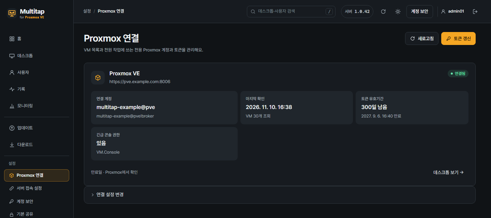
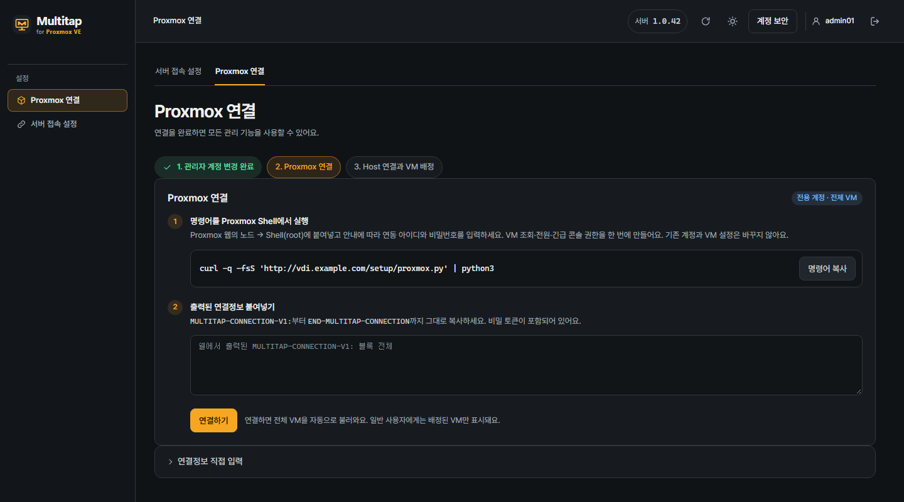

# 3. Connect Proxmox

[Contents](README.md) · [Previous: Server install](02-server-install.md) · [Next: Install Host](04-host-install.md) · [한국어](../03-Proxmox-연결.md)

When the server is connected to Proxmox VE, it reads the QEMU VM list automatically.
Which desktops users see is assigned separately afterwards.

**Goal:** connect the Multitap server so it can handle the Proxmox VM list, power and Console.
One command creates every permission it needs. There is nothing to add later.
Open the **Multitap admin console** and the **Proxmox web UI** in the browser on your PC.

| Screen to open | What you do there in this chapter |
| --- | --- |
| Multitap admin console | Copy the setup command → paste the connection settings |
| The node **Shell** in the Proxmox web UI | Create the dedicated integration account |

The commands in this chapter go into **the Shell of a Proxmox node**.
Do not confuse it with the Linux server terminal from the previous chapter or a Windows VM console.

The picture above is **an example after the connection is made**.
At first you see the connection setup page below.

## Step 1. Copy the setup command

1. Sign in to the Multitap admin console.
2. Open **Proxmox connection** in the left menu.
3. Click **Copy command**.
4. In the Proxmox web UI, select the node that manages the VMs.
5. Open the node's **Shell**.
6. Paste the copied command into the root Shell.
7. Press Enter.

The command downloads the setup script from your Multitap server.
Use the command the admin console shows rather than an example from a document.
If you see **This is the Multitap server** or **This is not a Proxmox node**, you pasted it somewhere else. Run it again in the **Shell** of a Proxmox node.

In the Proxmox tree on the left, **the server name under Datacenter** is the node.
If you select a Windows VM under it, you get the VM's **Console** instead of the node's **Shell**, so check where you are.

## Step 2. Create the dedicated API account

1. Under **[1/3] Proxmox address**, if the address found automatically shows **✔**, just continue.
2. If it shows **⚠** and asks for an address, enter the Proxmox management address you usually open in your browser.
3. Under **[2/3] Integration account**, enter a **New integration ID**. Press Enter alone to use the name in brackets.
4. Check what will be created and the privileges shown.
5. To create them, type `y`.
6. Enter a password for the new integration account.
7. Enter the same password again.

Nothing appears on screen while you type the password.
`multitap-` is added in front of the ID automatically.
To choose the address from the start, add it at the end of the command. For example: `… --lang en https://pve.example.com:8006` (just add the address at the very end, after a space)

The **New integration ID** is the dedicated name the Multitap server uses to reach Proxmox.
Choose a new name, not one of your existing Proxmox admin IDs.

> The Proxmox address and the Multitap address are different.
> Enter the Proxmox address that manages the VMs.

The script creates a dedicated user, a role and an API token.
The role holds the VM read, power and Console privileges from the start.
It does not overwrite existing accounts or change VM power or configuration.

The messages follow `--lang ko` or `--lang en` in the command. Without it they follow the Shell's language setting: Korean when it is Korean, English otherwise.

## Step 3. Paste the connection settings

1. In the Shell output, copy everything from `MULTITAP-CONNECTION-V1:` to `END-MULTITAP-CONNECTION`.
2. Go back to the **Proxmox connection** page in Multitap.
3. Paste the whole block into **Paste the printed connection settings**.
4. Click **Connect**.
5. Check that the connection status at the top shows **Connected**.

> The connection settings contain a secret API token.
> Do not post them on a board or in a chat, and keep them out of screenshots.

The **Desktops** list shows only VMs with an installed and approved Host.
You do not need to import VMs first. When a Host asks to connect, the server finds that VM in Proxmox.
Create and delete VMs in Proxmox.

**Check:** the **Proxmox connection** page shows **Connected**.
When you install the Host on a VM in the next chapter, it appears under **Desktops**.

When you see **Connected**, go to [chapter 4: Install Host](04-host-install.md).

## If it does not connect

| What to check | What to do |
| --- | --- |
| Management address | Check the Proxmox address and port you use in the browser. |
| Access from the server | Check that the broker container can reach the Proxmox address. |
| Certificate name | Check that the address matches the name in the certificate. |
| Private CA | Check that the CA printed by the setup script is in the connection settings. |

Make the address and the certificate match instead of turning off certificate checks.
If you set up a token yourself, you can use **Enter connection settings manually**.

## Certificate and token warnings

When the Proxmox connection has a problem or an expiry is near, a warning appears at the top of the admin console and in **To do now** on **Home**.

| Warning | What to do |
| --- | --- |
| **The Proxmox certificate changed** | Power, Console and status checks have stopped. Run the command on the **Proxmox connection** page again in the **Shell** of a Proxmox node, and paste the printed connection settings into **Change connection settings**. |
| **The Proxmox certificate has expired** | Renew it in Proxmox, then paste the connection settings again the same way. |
| **Couldn't verify the Proxmox certificate** | Check the address and certificate with the [If it does not connect](#if-it-does-not-connect) table above. |
| **Proxmox certificate expires in N days** | The node certificate pinned in the connection settings expires soon. Renewing it in Proxmox stops the connection, so paste the connection settings again after renewing. |
| **Proxmox token expires in N days** | Extend it with **Renew token** below. |

Expiry warnings start 30 days before and turn red 7 days before.
The pinned certificate's expiry date is in the **Proxmox certificate** row on the **Proxmox connection** page.

Later: check and renew the token's validity

The dedicated account and token are valid for 365 days at first.
At the top of **Proxmox connection** in the left menu, you can see the expiry date and the days left.

1. Click **Renew token**.
2. Copy the renewal command shown.
3. Run the command in the root **Shell** of a Proxmox node.
4. Check the renewal details shown in the Shell.
5. To renew, type `y`.
6. Paste the printed `MULTITAP-RENEWAL-V1:` block into the renewal window.
7. Click **Confirm renewal**.

Renewal keeps using the existing account and token.
You do not need to enter a new password or token secret.

When it says the emergency Console permission is missing

An integration account may lack the emergency Console permission (`VM.Console`).
Without it, users cannot open Console from the app.
Then **Emergency Console permission** on the **Proxmox connection** page shows **None**, with a notice and a command below it.

1. **Copy** the command shown.
2. Run it in the root **Shell** of a Proxmox node.
3. Check what it shows and type `y`.
4. Return to Multitap and click **Check permission**.

When it changes to **Present**, the notice disappears.

No command is shown for an account not made by the Multitap command.
A Proxmox administrator adds `VM.Console` to that account's `/vms` permission directly, then clicks **Check permission**.

Details: the dedicated account's privileges

The dedicated account gets inherited privileges on current and future VMs under `/vms`.

| Privilege | Used for |
| --- | --- |
| `VM.Audit` | Reading the VM list, status and configuration |
| `VM.PowerMgmt` | Start, shut down, restart, force stop |
| `VM.Console` | Console (the Proxmox console users open from the app) |
| `VM.GuestAgent.Audit` (Proxmox VE 9) or `VM.Monitor` (Proxmox VE 8) | Checking that Windows is up |

It gets no privilege that changes VM hardware.
Add a sound device (audio device) to the VM yourself in Proxmox: **Hardware → Add → Audio Device**.
Multitap does not use `VM.Config.HWType`. If a role has it, you may remove it in Proxmox.

These Proxmox privileges are separate from Multitap user assignments.
Regular users can use only the desktops assigned to them in Multitap.

