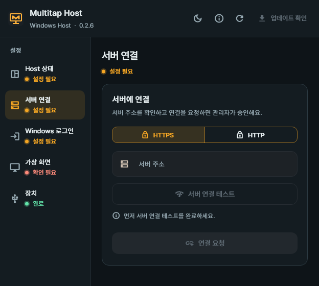
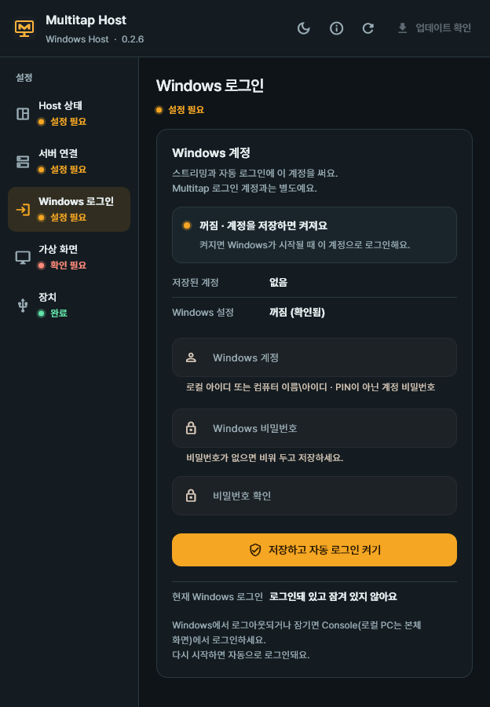
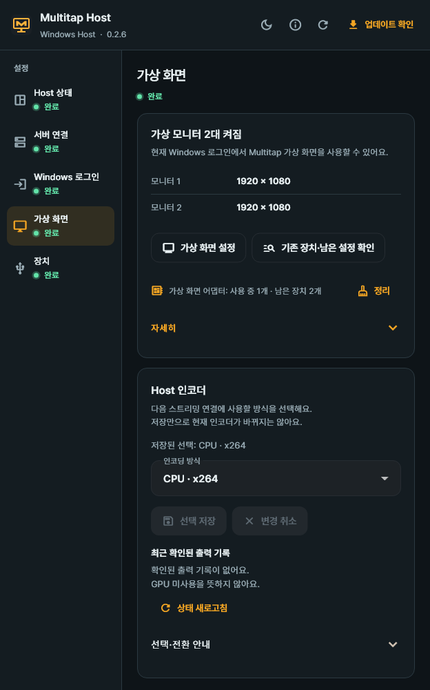
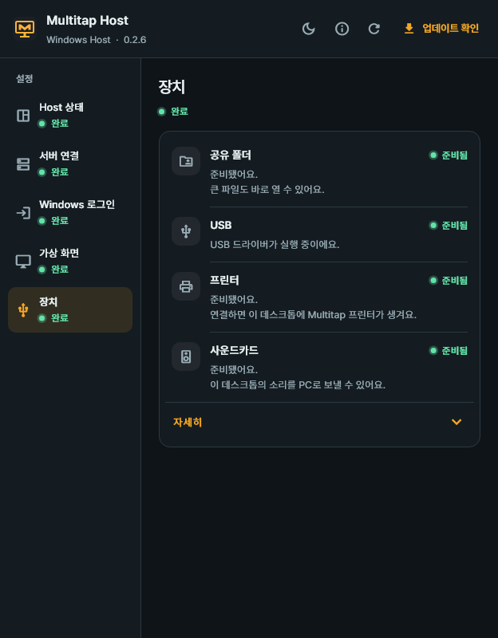

# 4. Install Host — VMs and local PCs

[Contents](README.md) · [Previous: Connect Proxmox](03-connect-proxmox.md) · [Next: Users and desktop assignment](05-users-and-desktops.md) · [한국어](../04-Host-설치.md)

You install Host inside the Windows that will become a desktop.
Proxmox VMs and physical Windows PCs use the same installer.

**Goal:** Windows gets ready to send its screen, and an admin approves that Host.
In the steps below you move between **the Windows that will become a desktop** and **the admin console on your PC**.

| Steps | Where | What to do |
| --- | --- | --- |
| Steps 1–2 | Inside the Windows that will become a desktop | Install Host and finish installation → request a connection to the server |
| Step 3 | The admin console on your PC | Compare the verification code and approve |
| Steps 4–6 | Back inside that Windows | Check the Windows account, virtual display and devices |

For a VM, open that VM's **Console** in Proxmox and sign in to Windows.
For a physical PC, work in front of that PC.

## Step 1. Run the installer

**Where: inside the Windows that will become a desktop**

1. In that Windows, open the Host download address of your Multitap server.

   ```text
   https://vdi.example.com/get/host
   ```

2. Run the downloaded `Multitap-Host-<version>-windows-x64.exe`.
3. Approve the Windows request for administrator rights.
4. Wait until the installation progress window closes. There is no button to press.
5. When installation ends, **Host settings** opens on its own.

Replace the example domain with your real server address.
For HTTP on an internal network, use `http://<server IP>:18480/get/host`.

Host installs like any other Windows program. Later you can repair or remove it from **Apps** in Windows Settings.

### Finish installation — virtual display driver and WinFsp

On a new Windows, Host settings starts finishing the installation on its own the first time it opens.

1. Read the **Trust the virtual display driver's signature?** window.
2. Press **Trust and install**.
3. The virtual display driver and the shared folder component (WinFsp) install next. Do not close the window; wait.

You are asked to agree only this once.
The virtual display driver is the original, signed by Sunshine, used unchanged.
When you agree, that one signing certificate goes into the Windows trust stores (Root and TrustedPublisher). The certificate is for code signing only.

If you cancelled or it failed, press **Finish installation** again under **Installation unfinished** at the top of **Overview**.
If you are told to restart Windows, save your work and then restart. Windows does not restart on its own.

**Check:** Host settings is open and **Installation unfinished** is not shown.

## Step 2. Request a connection to the server

**Where: Host settings in the same Windows**

Find **Multitap Host** in the Start menu and open it.
If it is already running, choose **Open Host settings** from the Multitap icon in the notification area.

Choose the language of Host settings with the **Language** button at the top: **Auto**, **한국어** or **English**. **Auto** follows the Windows language.



1. Open Host settings.
2. Open **Server connection**.
3. In **Server address**, enter the address the admin chose.
4. Press **Test server connection**.
5. For an HTTP address, read the encryption warning.
6. If you use HTTP at that address, press **Use HTTP for this address**.
7. Press **Request connection**.
8. Tell the admin the **Verification code** on the screen.

An example server address is `https://vdi.example.com`.
For an HTTP-only install, use your real server's `http://<server IP>:18480` address.

> You do not enter a registration code on the Host screen.
> The admin compares the verification codes on both screens and then approves.

Even if you close the settings window, the Windows service keeps checking for the approval result.

**Check:** You see the notice that Host is waiting for admin approval, and the **Verification code**.
It is not approved yet, so this alone does not mean it is ready to connect.

## Step 3. Admin approval

**Where: the Multitap admin console in a browser on your PC**

Compare the verification code in the Host window with the code in the admin console, side by side.
Requests waiting for approval appear in **To do now** on **Home**, and in **Waiting for approval** at the top of **Desktops**.

### Proxmox VM

1. Open **Desktops** in the admin console.
2. In **Waiting for approval** at the top, check the Windows name of the request.
3. Compare the request's **Verification code** with the Host screen.
4. Check that **VM found in Proxmox** is the right VM.
5. If the codes match, press **Check and approve**.
6. In the dialog, check **Proxmox VM to connect**.
7. Press **Approve connection**.
8. Check that the desktop shows as **Available** in the list.

> If the codes differ, do not approve.
> If there are several requests for the same VM, pick the one whose code matches the real Host screen.

The request shows the VM the server found in Proxmox, so you do not enter a node or VM ID.
If it says the VM was not found, press **Enter manually**, enter the Proxmox node and VM ID, and select **Check the code on the Host screen**.

Select **Replace existing Host** only when you are replacing an existing Host.
Replacing disconnects the existing Host.

### Local PC

1. Open **Desktops** in the admin console.
2. In **Waiting for approval** at the top, check the Windows name to register.
3. Compare the request's **Verification code** with the Host screen on that PC.
4. If the codes match, press **Register as local PC** on the same request.
5. Enter a **PC name**.
6. Under **Check the code on the Host screen**, select **I checked that it matches the code on the Host screen**.
7. Under **Register without Proxmox**, select the confirmation.
8. Press **Register PC**.
9. Check that the PC shows as **Available** in the list.

**Register as local PC** appears on requests for which the server found no matching VM in Proxmox.

Local PCs have no Console.
To start a local PC, the PC needs Wake-on-LAN set up and the server needs access to its LAN.

**Check:** What you approved shows as **Available** in the **Desktops** list, and Host shows the approval too.
Check again that you registered the right VM or PC.

### Copied VMs

A Host registration is used only on the Windows it was approved on.
On a VM made by cloning a registered VM, Host settings shows **This Windows looks like a copy of another registered desktop. Request a new connection for this desktop.**

1. In Host settings on the copied VM, open **Server connection**.
2. Press **Request connection**.
3. In the admin console, compare the verification codes and approve it like any other new Host.

The original VM keeps its registration and connection.
If a copied VM tries to connect with the original registration, the server refuses it, and **Logs → Admin actions** shows **Host on a copied desktop refused**.

## Step 4. Save the Windows sign-in account

**Where: back in Host settings in that Windows**



The picture above shows the screen **before an account is saved**.
If an account is already saved and you want to change it, press **Change account**.

The account you enter here is an account of this Windows.
A standard (non-administrator) Windows account can stream too.
It is separate from the account you use to sign in to Multitap.

Do not enter the PIN you use to sign in to Windows.
Have the **real Windows account password** ready for automatic sign-in.

1. Open **Windows sign-in** in Host settings.
2. In **Windows account**, enter the local user name or `<computer name>\<user name>`.
3. In **Windows password**, enter the account password.
4. In **Confirm password**, enter the same password.
5. Press **Save and turn on automatic sign-in**.
6. Check the account and the automatic sign-in notice in the confirmation window.
7. Press **Save and turn on** in the confirmation window.
8. Check the account save result and the automatic sign-in result separately.

**Check:** You checked the saved account name and the automatic sign-in result.
If a notice says it failed or only part was saved, do the next step that notice gives first.

> Use the Windows account password, not a PIN.
> Once saved, Windows signs in with this account automatically when it starts. Unlocking is separate.

If a Windows policy prevents automatic sign-in, the button may show **Check and save account**.
Do not take a notice that only the account was saved as automatic sign-in being done.

In that case the button in the confirmation window also shows **Save**.

### Accounts without a Windows password

1. In **Windows account**, enter the local account.
2. Leave both password fields empty.
3. Press the save button.
4. When **Create a new password** appears, enter a **New Windows password**.
5. In **Confirm new password**, enter the same password.
6. Press **Create password and save**.
7. Check the Windows account shown in the confirmation window.
8. If you agree to change the password, press **Create password**.
9. Check the password creation, account save and automatic sign-in results separately.

> This creates a password on the real Windows account.
> From the next Windows sign-in, the new password is needed.

## Step 5. Check the virtual display

The virtual display lets Windows make a screen even without a physical monitor.
The number of monitors and the resolution are prepared to match the client when you connect.



1. Open **Virtual display** in Host settings.
2. Press **Refresh virtual display status**.
3. Check the ready state and any restart notice.
4. If setup is needed, press **Set up virtual display**.
5. Read the notice about the screen switching.
6. Press **Set up** in the confirmation window.
7. Check the result.

If it is already ready, you do not need to set it up again.
If **Set up virtual display in the Proxmox console** appears, do it in the VM's **Console** in the Proxmox web interface.

Streaming uses only the Multitap virtual display.
It uses 1 or 2 displays to match the client's monitors, and restores the previous display state when the connection ends.

## Step 6. Check devices



1. Open **Devices** in Host settings.
2. Check the state and next step for the devices you need.

| Item | When needed |
| --- | --- |
| Shared folder | If **Install WinFsp** appears, install it and check the result. |
| USB | The driver installs on its own the first time you connect. |
| USB — in use by another program | Switch the controller with **Switch to Multitap**. |
| Printer | If **Start print spooler** appears, you can start the Windows print service. |
| Sound device | If the VM has no sound device, add one in Proxmox (**Hardware → Add → Audio Device**). |

> Switching the USB controller disconnects other programs' USB connection features and the devices connected through them.
> Read the confirmation window, then press **Switch**.

If you added a sound device to a running VM, restart the VM from Proxmox to apply it.
Restarting only inside Windows may not apply Proxmox's pending device changes.

Even when a device is ready, a user cannot use it without sharing permission.
Set [per-user permissions in the next chapter](05-users-and-desktops.md).

## Tray icon

Right-click the Multitap icon in the Windows notification area to see this menu.

| Menu | What it does |
| --- | --- |
| **Open Host settings** | Opens the Host settings window. |
| **Refresh status** | Checks the service state again. |
| **Close tray icon** | Closes only the icon. The service and remote connections keep running. |

Finally, check the server connection, Windows sign-in and virtual display in **Overview**.
Even if the admin console shows **Available**, check each ready item on its own.

## Good to know while in use

- **Screen:** While streaming, only the Multitap virtual display is on. When it ends, the original display setup comes back.
- **The VM's display setting:** Streaming works whatever the VM's Proxmox display is (VirtIO, QXL, none and so on). It also works while Proxmox is briefly unreachable.
- **Console screen:** While Console is open, only the VM's basic (Proxmox) display is on. When it closes, the other displays come back. A VM whose Proxmox display is none or serial, or whose passed-through GPU is the primary VGA, has no picture for Console. If you need Console, set **Hardware → Display** to **Standard VGA** in Proxmox and restart the VM.
- **Sign-out and lock:** The Windows sign-in screen is not streamed. Sign in with **Console** in the client, or **Restart**. Windows signs in automatically with the saved account. On a VM with a PCI device such as a GPU, the sign-in screen may be on a display Console cannot show. Then **Restart**.
- **Moving and restoring VMs:** If you move the VM to another node or restore it to a new VM ID, the desktop follows the VM ([chapter 5](05-users-and-desktops.md#when-you-move-or-restore-a-vm)).
- **Security prompts (UAC) and administrator windows:** You can see and use prompts that appear on the normal desktop, and windows run as administrator, inside the stream. Windows UAC settings are not changed. Cases that do not work yet are listed in [Troubleshooting](09-troubleshooting.md).
- **Removal:** Remove Multitap Host from **Apps** in Windows Settings. The virtual display driver, the signing certificate and WinFsp stay.

## Before the next chapter

- [ ] You finished installation.
- [ ] You approved the right VM or PC in the admin console.
- [ ] You checked the Windows account saved in Host and the automatic sign-in result.
- [ ] You checked the ready state of **Virtual display** and any action needed.

If errors remain, see [Host and virtual display troubleshooting](09-troubleshooting.md).
When everything is ready, go to [Chapter 5: Assign desktops to users](05-users-and-desktops.md).
