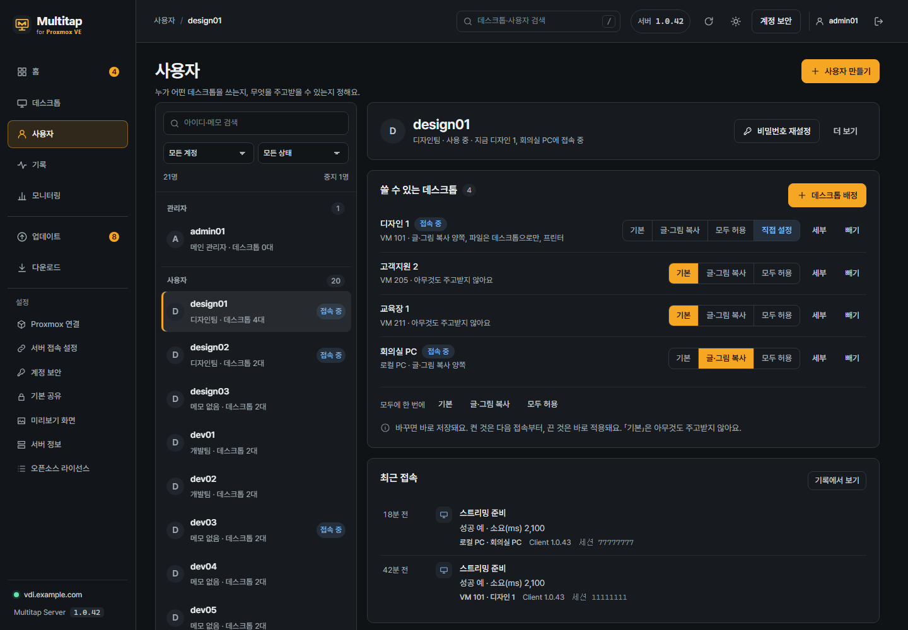
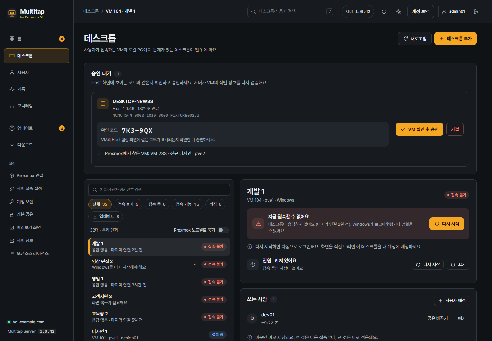
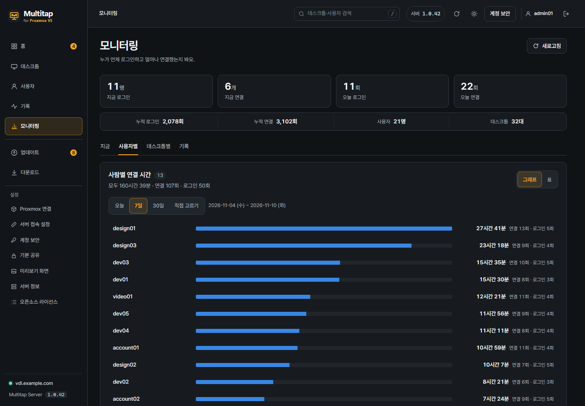

# 5. Users and desktop assignment

[Contents](README.md) · [Previous: Install Host](04-host-install.md) · [Next: Windows client](06-windows-client.md) · [한국어](../05-사용자와-VM-배정.md)

Users see only the desktops (VMs and local PCs) an admin assigned to them.
You set assignments and sharing in **Users** in the admin console.

**Where: the Multitap admin console in a browser on your PC**

**Goal:** Create one user and assign one desktop to that user.

At first you can stop after **Create user → Assign desktops**.
Turn on sharing features such as copy and USB later, only the ones you need.

## Admin console menu

Every screen opens straight from the menu on the left. The menu has three groups, and the last group has the title **Settings**.
On phones and narrow windows, press the **Menu** button (three lines) at the top of the screen to open the same list.

| Menu | What it does |
| --- | --- |
| **Home** | Shows what to do now and who is connected. |
| **Desktops** | Add desktops (VMs and local PCs) and manage their state, power and Host. |
| **Users** | Create accounts, assign desktops and set sharing. |
| **Logs** | Find the cause when a connection failed. Picture quality, speed and admin actions are here too. |
| **Monitoring** | See who signed in when, and how long they were connected. |
| **Notices** | Send a notice to everyone signed in, to one person, or to the people on one desktop. |
| **Updates** | Check for and apply new server and Host versions. A number appears when there is something to update. |
| **Downloads** | The Windows client, Android app and Host installer, with short addresses. |
| Settings › **Server access** | Set the server address and ports that clients and Hosts connect to. |
| Settings › **Proxmox connection** | Manage the Proxmox account and token used for the VM list and power. |
| Settings › **Account security** | Manage two-step sign-in and recovery codes for your admin account. |
| Settings › **Backup and restore** | Download server data as a backup file, and restore from that file. |
| Settings › **Server info** | See the server address, version, deployment type and the protections that always apply. |
| Settings › **Open-source licenses** | The open-source components in the server and their full license texts. |

Admin accounts are grouped in **Admins** at the top of the **Users** list.

### Desktops screen

In **Desktops** you manage desktops and their Hosts together.

- Connection requests from new Hosts appear in **Waiting for approval** at the top.
- Desktops with problems come first in the list.
- Press a row to open a detail window with the cause and fix buttons, power, **Used by** and Host info.

## Step 1. Create a user account

1. Open **Users** in the admin console.
2. Press **Create user**.
3. Enter a **Username**.
4. Under **Role**, select **Standard user**.
5. If needed, enter a note in **Note (optional)**.
6. Enter a **Password** of 10 or more characters.
7. In **Confirm password**, enter the same password.
8. Press **Create user**.

The new account's screen opens.
A username has 2 to 64 characters with no spaces, and Korean letters are allowed.

**Check:** The new username appears in the user list.
This is the account for signing in to the Multitap app. Keep it apart from the Windows account in Host.

> An **Admin** can also manage the server and other users.
> For accounts that only connect, select **Standard user**.

## Step 2. Assign desktops

1. Press the user to assign to, to open the detail window.
2. Under **Desktops they can use**, press **Assign desktops**.
3. Check the desktops to use.
4. Press **Assign**.

Only desktops with a registered Host appear in the list.
If there are many, you can search by name or VM number.

> It saves as soon as you press. There is nothing else to apply.

A disabled account must be turned back on before you can change its assignments.

**Check:** The assigned desktops appear in **Desktops they can use**.

To remove an assignment, press **Remove** on its row.
The sharing settings of that assignment are deleted too, and if the user is connected, the connection ends.

## Step 3. Set sharing

Sharing is saved separately for each **user × desktop**.
A new assignment starts at **Basic**, which exchanges nothing.

Even with **Basic**, the user can see the desktop screen and use the keyboard and mouse.
You do not need to turn on sharing to check the first connection.

Choose one on the assigned row.

| Choice | Meaning |
| --- | --- |
| **Basic** | Nothing is exchanged. |
| **Copy text and images** | Allows copying and pasting text and images both ways. |
| **Allow all** | Allows copy and paste and all device sharing. |
| **Custom** | Items were turned on and off one by one in **Details**. |

It saves as soon as you choose, and **Saved** appears.

### Details: copy and paste

**PC** is the computer in front of the user. **Desktop** is the remote Windows they use.

| Item | Allows |
| --- | --- |
| **Text and images** · PC → desktop | Pasting text and formatting copied on the PC into the desktop |
| **Text and images** · desktop → PC | Pasting text and formatting copied on the desktop into the PC |
| **Files** · PC → desktop | Pasting files, folders and images from the PC into the desktop |
| **Files** · desktop → PC | Pasting files, folders and images from the desktop into the PC |

Pasting images also needs **Files** in that direction.
If only **Text and images** is on and images do not paste, turn on **Files** too.

Files are not sent when copied.
The transfer starts when the user pastes.

### Details: devices

| Item | Allows |
| --- | --- |
| **Shared folder** | Opening a PC folder the user chose on the desktop |
| **Printer** | Printing documents from the desktop on the user's printer |
| **USB device** | Connecting USB devices on the user's PC to the desktop |
| **Smart card** | Using a USB smart card reader |
| **Serial (COM) port** | Using USB serial devices |

**Smart card** and **Serial (COM) port** appear when you expand **Rarely used**.

USB storage needs both **USB device** and **Shared folder** on.
USB printers, smart cards and serial devices also need **USB device** on together with their own item.

USB devices cannot be used on Android ([Android chapter](07-android.md)).
The **Devices** screen in Host shows the ready state; it does not allow sharing for users.

### When changes apply

| Change | How it applies |
| --- | --- |
| Turning on copy and paste | With apps 1.1.13 and later, applies at once, also to an ongoing connection. An older app, or a connection that started with copy and paste all off, gets it from the next connection. |
| Turning on shared folder, printer or USB | Applies from the next connection. |
| Turning off copy and paste | The ongoing connection and transfers on that desktop end. |
| Turning off shared folder, printer or USB | The screen stays; only that sharing is removed. |

A confirmation window appears only when you turn off sharing for a connected user.
Files already delivered to the other side are not deleted when you turn sharing off.

## Same sharing for several items

If a user needs the same sharing on all their desktops, choose it in **All at once** below the list.

You can also change sharing for the several users of one desktop in **Desktops → that desktop → Used by**.
There you find **Everyone at once**.

## What to give users

| Information | Example or note |
| --- | --- |
| Server address | `https://vdi.example.com` or the internal-network HTTP address the operator chose |
| Multitap username | The username you just created |
| Initial password | Give it by a separate, secure way |
| Client download | `/get/client` or `/get/android` on the server |

You can copy the download addresses from **Addresses to give users** in **Downloads**.

Users sign in to the client with this account.
The Windows account saved in Host is managed in the [Host install chapter](04-host-install.md#step-4-save-the-windows-sign-in-account).

## Check the first connection

1. Install the [Windows app](06-windows-client.md) or the [Android app](07-android.md) on the device to use.
2. Sign in with the **standard user account** you just created.
3. Check that the assigned desktop's card appears.
4. Press **Stream** on that card.
5. On the desktop screen, check the mouse and typing.

If the list is empty, check that user's **Desktops they can use** again in **Users** in the admin console.
If the card appears but does not connect, look up the error shown on the card in [Troubleshooting](09-troubleshooting.md).
**Logs → Find problems** in the admin console shows the cause and fix for each failed connection.

## See who used how much (monitoring)

You see this in **Monitoring** in the admin console.

| View | Shows |
| --- | --- |
| **Now** | Who is connected and who is signed in now, client type and version, the address they came from, and when they started |
| **By user** | Compares each person's connection time as bars over a period (today, 7 days, 30 days, custom). Press a name to see time per day and the list of connections. |
| **By desktop** | Shows how long each desktop was used and by whom. |
| **History** | Shows a day's sign-ins and connections per person; search by name, address or desktop. |

**Chart** and **Table** show the same numbers.

> **Connection time** is the time connected to a desktop. It includes time away from the desk, so it is not the same as time worked.

Sign-in and connection history is kept on the server for 2 years. It includes the IP address the user connected from.
Deleting an account deletes its history too.
A day follows the server's time zone, which is shown at the bottom of the screen.
A connection marked **Estimated** has an end time the server estimated (when the client disappeared without a word or the server was off).

## Disabling accounts and resetting passwords

**Reset password** is at the top of the user screen; **Disable account** and **Delete** are under **More**.

**Disable account** ends existing sign-ins but keeps assignments and sharing.
If a user forgot the password, set a new one with **Reset password**.

Resetting the password, changing the role or deleting ends that account's existing sign-ins.
The first **Main admin** cannot be demoted, disabled or deleted.

## When you move or restore a VM

If you move a VM to another node in Proxmox (migration, HA) or restore its backup to a new VM ID, the desktop follows the VM.
Assignments, sharing and the Host registration stay. You do not need to approve or assign again.

The server finds the VM by the VM's unique ID it recorded when the Host was approved.
If several VMs have the same unique ID, it does not follow any of them.
Each move is recorded as **Desktop VM moved** in **Logs → Admin actions**, with the node and VM number before and after.

## Deleting a desktop

In **Desktops**, check the desktops to delete and press **Delete selected**, or press **Delete** in the detail window.
In the confirmation box, type the desktop name (or 'delete' for several).
Their assignments and permissions are deleted too; the VMs, files and user accounts stay as they are.
