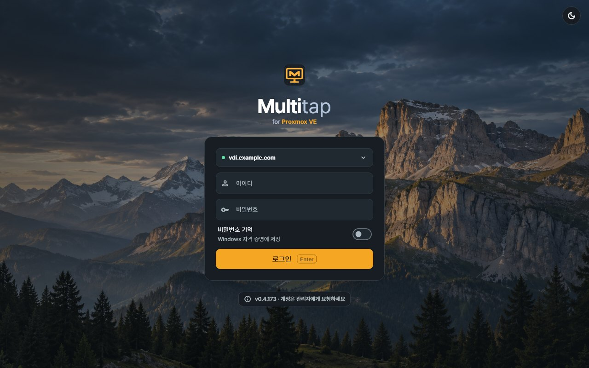
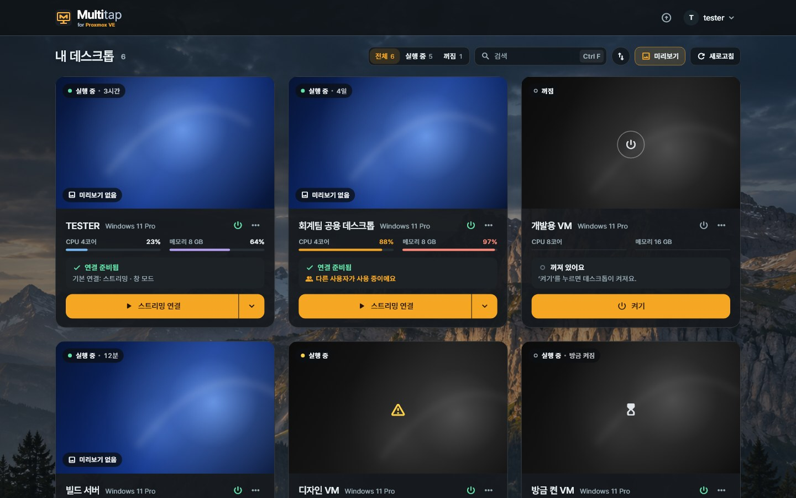
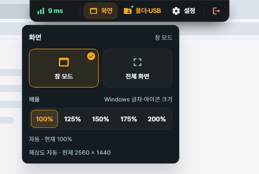
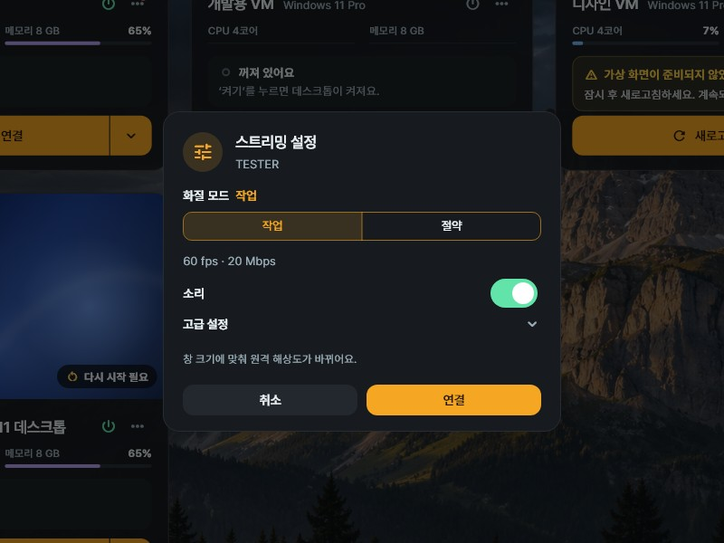

# 6. Windows client

[Guide contents](README.md) · [Previous: Users and desktop assignment](05-users-and-desktops.md) · [Next: Android](07-android.md) · [한국어](../06-Windows-클라이언트.md)

The Windows client is the app you use on your PC to connect to the desktops assigned to you.
A **desktop** is the Windows you use remotely (a Proxmox VM or a local PC), and your **PC** is the computer in front of you.
The desktop must have the Host installed.

## Your first connection

**Where: the Windows PC you will use**

First get the **server address, Multitap username and password** from your administrator.

| Step | What to do | How to check |
| --- | --- | --- |
| 1 | [Install the app](#install-and-sign-in) | The Multitap client opens on your PC |
| 2 | [Test and save the server address](#save-the-server-address) | The connection is confirmed and the address is saved |
| 3 | [Sign in with your account](#sign-in-with-your-account) | Your assigned desktops appear in **My desktops** |
| 4 | [Connect via streaming](#connect-via-streaming) | The desktop screen appears in a separate window |

For the first connection, leave the quality, scale and USB settings as they are.
Once you see the screen, try the features you need one at a time.

## Install and sign in

1. Open `https://vdi.example.com/get/client`, the address your administrator gave you.
2. Run the downloaded installer and approve the Windows administrator prompt.
3. When the installation finishes, start Multitap.

Replace `vdi.example.com` in the example with the real server address from your administrator.
For an HTTP server, download from `http://<server IP>:18480/get/client`.

Windows may show a **Windows protected your PC** or **Unknown publisher** warning, because the installer has no purchased code signing certificate ([Troubleshooting](09-troubleshooting.md#defender-or-smartscreen-blocks-the-install)).

The app runs without administrator rights.
Windows asks for administrator approval only when you install, update or install the USB driver.
Clicking X on the window hides the app in the tray. To close it completely, click **Quit** in the account menu.

### Save the server address

1. On the sign-in screen, click **Server setup needed**.
2. Choose **HTTPS**, or **HTTP** if your administrator told you to.
3. In **Server address**, enter `https://vdi.example.com`.
4. Click **Test connection**.
5. When **Connection confirmed** appears, click **Save**.

If an address is already set, click the server address at the top of the sign-in screen to change it.
After you change the address or the connection type, run **Test connection** again.

Include the leading `https://` or `http://` and the port if one is needed.
Leave out any path such as the browser's `/admin/`, and use **only the server address part**.

> **HTTP warning:** your sign-in details, screen and input are not encrypted. Use it only on a trusted internal network.

For HTTP, also enter the port your administrator gave you. Example: `http://vdi.example.com:18480`.
Read the warning, then click **Use HTTP for this address**.

### Sign in with your account

1. Enter the **Username** your administrator created.
2. Enter your **Password**.
3. To save the password on your PC, turn on **Remember password**.
4. Click **Sign in**.

The username is remembered per server.
The password is saved in the credentials of the current Windows user. On a shared PC, turn **Remember password** off.
A saved password is filled in on the sign-in screen even after you sign out.

Accounts with two-step verification are asked once more for the 6-digit code from the authenticator app or a recovery code.

**How to check:** the **My desktops** list appears instead of the sign-in screen.
If the password does not work, ask your administrator about your account. If the list is empty, ask for a desktop assignment.

## Find your desktops

After you sign in, only the desktops assigned to you appear as cards.

| Item | How to use it |
| --- | --- |
| **Type** | Choose **All**, **VM** or **Local PC**. It appears when you are assigned both kinds. |
| **Status** | Choose **All**, **Running** or **Off**. |
| Search | Find by name, number or category. `Ctrl+F` opens the search. |
| **Previews** | Turns the screen pictures on the cards on or off. |
| **Refresh** | Checks the list and connection readiness again. |
| **▾** | Opens the connection mode (**Windowed**, **Full screen**, **All monitors**), **Streaming settings…** and **Console**. |
| **⋯** | Opens favorites, **Check readiness** and Host update. The available items differ per desktop. |
| **⏻** | Opens the power actions you are allowed to use. |

Cards are laid out automatically to fit the window width.

A preview is a recent screen and may differ from the current one.
The lock screen and the Windows sign-in screen are never captured for previews.

### Start and shut down

1. Click **⏻** on the card.
2. Choose the action you need.
3. In the confirmation window, check the target and the effect, then run it.

| Action | What it does |
| --- | --- |
| **Start** | Starts the desktop. A local PC can be started only when Wake-on-LAN is set up. |
| **Shut down** | Asks Windows to shut down normally. |
| **Restart** | Restarts Windows. The connection is closed. |
| **Stop** | Cuts the VM's power at once. Not available for local PCs. |

> **Stop warning:** unsaved work can be lost. Use it only when Windows does not respond.

On a card that is off, the power symbol in the middle of the picture and the **Start** button below do the same thing.
If a power action is disabled, check the reason shown.

## Connect via streaming

If the card is **Off**, start it first with **Start**. You can connect once it is on.
If you see a readiness error, read that message first ([Troubleshooting](09-troubleshooting.md)).

1. Click **Stream** on the card. The **▶** on the card picture does the same.
2. In the **"Connect to <name>?"** confirmation window, check the target and the connection mode.
3. Click **Connect**.
4. When the screen appears, click inside it.

A connection starts only from **the connect button and ▶**. Clicking the card body or pressing Enter on the keyboard does not connect.
The confirmation window appears before every new connection, and if you click **Cancel**, no request is sent.
In a narrow window, the button is shortened to **Connect**.

The desktop screen opens in a separate window, and the list stays open.
When you close the window, you are asked **Disconnect?**. Only the connection is closed; the desktop's power and work stay as they are.

### When someone else is using it

If the desktop is assigned to you, the **Connected somewhere else** notice shows the connected account and the time it started.
After you check it, click **Disconnect and connect here**. The other connection is closed at once and you are connected.
The desktop and the work running on it stay as they are.

### Things to try on the first screen

1. Open the Start menu on the desktop.
2. Run **Notepad**.
3. Type a few characters.
4. Drag the Notepad window by its title bar.

**How to check:** the characters appear in Notepad, and the window follows when you drag it.
If you need Korean input, click the screen and check the **Han/Eng** (한/영) key as well.

The basic connection is now done.
For text size use [scale](#resolution-and-scale), for copying files use [copy and paste](#copy-and-paste), and to finish use **Disconnect** on the toolbar.

### Windows key and the Han/Eng key

While input goes to the desktop after you click inside the screen, the Windows key, `Alt+Tab` and similar keys are sent to the desktop.
The keyboard's **Han/Eng** (한/영) key also switches the desktop's input language.

1. To return keyboard input to your PC, press `Ctrl+Alt+Shift+F12`.
2. To send it to the desktop again, click inside the screen.

Opening the toolbar or moving to another window also returns input to your PC.
`Ctrl+Alt+Del` cannot be sent over streaming. Open Task Manager with `Ctrl+Shift+Esc`.

## Session toolbar

The toolbar opens when you click the small handle at the top center of the desktop window.
The handle shows the latency. There are five items.

| Item | What it does |
| --- | --- |
| **Connection quality** (shows latency) | Shows round-trip latency, screen frames, received video and the video path (UDP/TCP). **Show connection stats** is here too. |
| **Screen** | Choose **Windowed**, **Full screen** or **All monitors**, and change **Scale** in the same panel. |
| **Folders and USB** | Has the **Shared folders** and **USB devices** tabs. Only what is allowed appears. |
| **Settings** | Has **Picture quality**, **Mouse lock**, **Guide** and **Keep toolbar open**. |
| **Disconnect** | Ends the current connection. The desktop's power and work stay as they are. |

The toolbar folds when you use an item or click the desktop screen. `Esc` folds it too.
To keep it open, turn on **Keep toolbar open** in **Settings**.
In full screen there is no window title bar, so the toolbar also shows **Minimize** and **Windowed** buttons.
In a narrow window, the middle items are grouped into one **Menu**.

For a grayed-out item, hover over it to see the reason.

### Resolution and scale

The resolution follows the size of the desktop window automatically.
To change the resolution, resize the window.

1. Click **Screen** on the toolbar.
2. Under **Scale**, choose **100%**, **125%**, **150%**, **175%** or **200%**.
3. Check the current scale and resolution shown at the bottom of the panel.

Scale changes the size of text and icons in Windows. New connections start at 100%.
The scales Windows allows can depend on the screen size.

### Using two monitors

1. Connect two monitors to your PC.
2. Click **Screen** on the toolbar.
3. Choose **All monitors**.

Your PC must have exactly two monitors, and the Host must support it.
Each monitor shows a different screen. The toolbar and panels appear on the main monitor.

Streaming uses the Host's Multitap virtual display.
While you are connected, the desktop's other displays are turned off, and when the connection ends, the original display layout comes back.

### Picture quality

1. In **Settings** on the toolbar, open **Picture quality**.
2. Choose a **Quality mode**, or change **Target frame rate**, **Video bitrate** and **Hardware decoding** in **Advanced settings**.
3. Click **Reconnect** to apply.

New connections default to **60 fps** and a bitrate of **Auto (recommended)**. If you saved your own settings, those values are used.
The automatic bitrate adjusts to the connection. You can see how much you are receiving now in **Connection quality**.
If the screen looks broken, turn **Hardware decoding** off and check again.

### Sound

The desktop's sound always plays on your PC's speakers. Set the volume on your PC.
If a card shows **No sound**, the desktop has no sound device.
Ask your administrator to add an audio device to the VM in Proxmox. The app does not add one.

### Mouse lock

Use it in programs that need relative mouse movement, such as games.
Keep it off for everyday use.

1. Click **Mouse lock** in **Settings** on the toolbar, or press `Ctrl+Shift+Alt+Z`.
2. To release it, press `Ctrl+Shift+Alt+Z` again.

Every new connection starts with mouse lock off.
While locked, a virtual USB mouse is connected when possible; otherwise it works with normal input.
With normal input, some games may not receive the mouse.
In that case, ask your administrator to check your USB sharing permission and the Host's USB status.

## Copying and sharing devices

Your administrator decides, per user and per desktop, what can be exchanged.
A new assignment starts as **Basic**, which exchanges nothing.
First check the features allowed for the current connection in **Guide** under **Settings** on the toolbar.

### Copy and paste

1. Select the source file or text.
2. Copy it with `Ctrl+C`.
3. Open the target folder or input field on the other side.
4. Paste it with `Ctrl+V`.

Text and images, and files, are allowed separately for each direction (PC → desktop, desktop → PC).
Files are transferred when you paste, not when you copy.
Pasting an image also needs the file permission for that direction.

When you first try it, start by copying a few characters.
If a file does not paste, check the file permission and direction in **Guide**.

### Shared folders

1. In **Folders and USB** on the toolbar, open the **Shared folders** tab.
2. Click **Add folder…** and choose a folder on your PC to share.
3. In the confirmation window, click **Share**.
4. Click **Open** to check it in File Explorer on the desktop.

The folder is attached to the desktop as a drive.
Programs on the desktop can read and change the files in the folder, so choose only the folders you need.
Sharing ends when you disconnect.

### Printer

1. Open the print window on the desktop.
2. Choose **Multitap Printer** and print.
3. Check the preview that appears on your PC.
4. Choose a printer and the number of copies, then click **Print**.

To keep it as a file, click **Save as PDF**.

### USB devices

1. In **Folders and USB** on the toolbar, open the **USB devices** tab.
2. If a driver notice appears, click **Install USB driver…** and confirm the Windows administrator prompt.
3. Click **Connect** for the device you want.
4. Use the device on the desktop.
5. When you are done, click **Disconnect** for the device.

While it is connected, you cannot use the device on your PC.
For a storage device, use **Safely Remove Hardware** on the desktop before you disconnect it.

If a device on your PC could not be read, the tab shows a line such as **1 USB device(s) could not be read. Unplug and plug in again.**
Unplug that device from your PC and plug it in again.

## Console — when signed out or locked

If Windows is signed out or locked, you cannot connect by streaming. The sign-in screen is not streamed.
In that case, use Console or restart.

- **Console:** opens the Proxmox VM's built-in screen inside the app. Sign in to Windows or unlock it there.
- **Restart:** **⏻ → Restart** on the card. If a Windows account is saved in the Host, it signs in automatically.

1. Click **▾** on the card.
2. Choose **Console**.
3. In the confirmation window, click **Open in Console**.

It connects with your current sign-in, so you do not enter your username and password again.
Console opens even when the Host is off. It is not available for local PCs.
If Windows asks you to install WebView2, install it as shown, then open Console again.

The Console tools hang from the small grip at the top center of the screen.
Click the grip for **Send Ctrl+Alt+Del**, **Text clipboard**, **Full screen** and **Help**.
The text clipboard works only in the directions your administrator allows, and it does not send characters such as Korean.

While Console is open, only the VM's basic (Proxmox) display is on. When you close Console, the other displays come back.
If you see **There is no picture for the Console**, tell your administrator. [Troubleshooting](09-troubleshooting.md#console-does-not-open-or-is-black) has what to do.

## Settings

Change the app settings with **⚙** (Settings) at the top of the desktop list.

| Item | What it does |
| --- | --- |
| **Language** | Choose **Auto**, **한국어** or **English**. **Auto** follows the Windows language. |
| **Auto sign-out** | Turns auto sign-out on or off for the current sign-in. |
| **Two-step verification** | Also asks for an authenticator app code when you sign in. |
| **Change password** | Changes your Multitap sign-in password. |

### Auto sign-out

With no keyboard or mouse input for 30 minutes, you are signed out automatically and the connection is closed.
A warning appears 1 minute before; click **Keep using** to stay.
You can turn this off for the current sign-in only with the **Auto sign-out** switch in **⚙** Settings.

[Guide contents](README.md)
