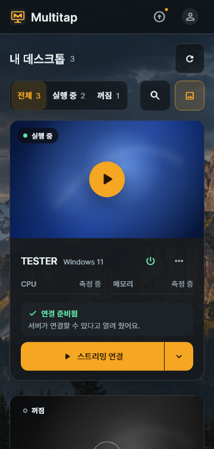
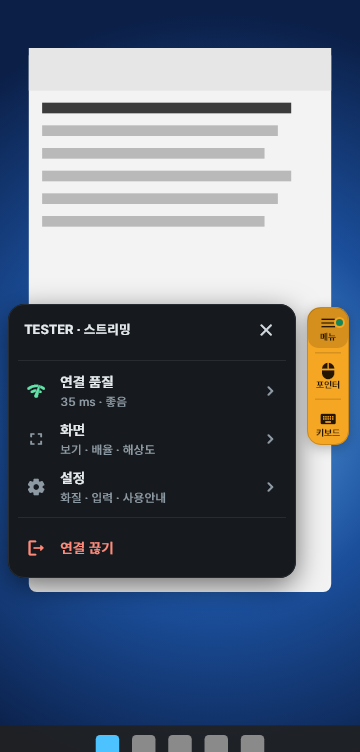

# 7. Android client

[Guide contents](README.md) · [Previous: Windows client](06-windows-client.md) · [Next: Updates](08-updates.md) · [한국어](../07-Android.md)

Use the Android client to connect to the desktops assigned to you (Proxmox VMs or local PCs).
This chapter describes the touch screen of a phone or tablet.

> USB devices cannot be connected on Android. Use the Windows client for USB devices.

## Your first connection

**Where: the Android phone or tablet you will use**

First get the **server address, Multitap username and password** from your administrator.

1. Follow [Install and sign in](#install-and-sign-in).
2. Tap [Stream on an assigned desktop](#choose-a-desktop-and-connect).
3. Tap [Keyboard on the amber buttons](#three-amber-buttons) and try typing.

**How to check:** the desktop screen appears in the app, and touch and typing work.
Start with the default **Pointer** mode, and try **Touch** once you are used to it.

## Install and sign in

1. On your Android device, open `https://vdi.example.com/get/android`, the address your administrator gave you.
2. Install the downloaded APK.
3. Start the Multitap app.
4. On the sign-in screen, tap **Server setup needed**.
5. Choose **HTTPS**, or **HTTP** if your administrator told you to.
6. In **Server address**, enter `https://vdi.example.com`.
7. Tap **Test connection**.
8. When the connection is confirmed, tap **Save**.
9. Enter the **Username** your administrator created.
10. Enter your **Password**.
11. If you want, turn on **Remember password**.
12. Tap **Sign in**.

To change the server, tap the address at the top of the sign-in screen.
After you change the address or the connection type, run the test again.
If the APK installation is blocked, check Android's prompt to allow installs from this source.

An APK is an Android app installation file.
Make sure the file came from the server your administrator gave you before you install it.
It works on Android 8.0 or later.

Replace `vdi.example.com` in the example with the real server address.
For an HTTP server, download from `http://<server IP>:18480/get/android`.

> **HTTP warning:** your sign-in details, screen and input are not encrypted. Use it only on a trusted internal network.

For HTTP, also enter the port your administrator gave you. Example: `http://vdi.example.com:18480`.
Read the warning, then tap **Use HTTP for this address**.

## Choose a desktop and connect

It uses the same card design as Windows.
The number of card columns changes automatically to fit the screen width.

1. In **Type**, choose **VM** or **Local PC**.
2. In **Status**, choose the power state you need.
3. Use search to find a name, number or category.
4. Tap **Stream** on the card you want.
5. Check the target in the connection confirmation window.
6. Tap **Connect**.

**Type** appears when you are assigned both VMs and local PCs.
On a narrow screen, the connect button shows **Connect**.
Tapping other parts of the card does not connect.
If you tap **Cancel** in the confirmation window, no request is sent.

**Previews** turns the recent screen pictures on or off.
On a small screen it shows a preview icon instead of text.

Use **⏻** on the card to choose an allowed power action (**Start**, **Shut down**, **Restart**, **Stop**).
**▾** has **Streaming settings…** and **Console**, and **⋯** has Host update and more.
If you **Stop** a VM, unsaved work can be lost.

The desktop's sound always plays. Set the volume on your device.
The resolution is set automatically to fit the device screen.

**How to check:** after you connect, the desktop screen appears in the app.
If the list is empty, ask your administrator for a desktop assignment. If you see a readiness error, follow the notice on the card.

## Three amber buttons

A small group of amber (yellow) buttons floats on the desktop screen.
From the top, they are **Menu**, **Input mode** and **Keyboard**.

| Button | One tap |
| --- | --- |
| **Menu** | Opens the session menu next to the button. |
| **Input mode** | Switches between **Pointer** and **Touch**. The button shows the current mode. |
| **Keyboard** | Opens or closes the on-screen keyboard. |

Drag the button group to move it where you want.
When you let go, it sticks to the edge of the screen, and it fades when you do not use it for a while.
You can use **Input mode** and **Keyboard** directly without opening the menu.

### Session menu

Tap **Menu** to see the same items as the Windows session toolbar, as rows.
Tap a row to open its panel in the same place, and tap **Back** at the top to return.

| Row | What it has |
| --- | --- |
| **Connection quality** | Round-trip latency, screen frames, received video, resolution and video path. **Show connection stats** shows Host processing and **Processing on this device** (time spent decoding and so on). |
| **Screen** | **Whole screen** and **Pan**, Windows **Scale** (five steps from 100 to 200%), **Resolution** (**Auto (recommended)** or **Fit to device**) |
| **Shared folder** | Connects a folder on this device to the desktop. It appears only on connections that allow it. See [Shared folders](#shared-folders). |
| **Settings** | **Picture quality**, **Mouse lock**, **Input mode** (including pointer speed), **Guide** |
| **Disconnect** | Ends the connection. |

The Android menu has **Shared folder**, but no USB devices.

### Screen and quality

The desktop's resolution adjusts automatically to fit the device screen.
Spreading two fingers enlarges only the picture shown on this device.
**Scale** changes the size of text and icons in Windows.

1. Open **Menu → Settings → Picture quality**.
2. Choose a quality mode, or the frame rate and bitrate.
3. Tap **Reconnect**.

For a desktop you connect to for the first time, the defaults are **60 fps** and an **Auto** bitrate.
If you saved settings, those values are used.
Check the frame rate and bitrate of the video you actually receive in **Connection quality**.

## Pointer and touch

**Pointer** moves a cursor, like a laptop trackpad.
It is the default input mode the first time you use the app.
**Touch** controls the spot you tap on the screen directly.

1. Tap the middle **Input mode** button to switch modes.
2. To change the pointer speed, press and hold the same button.

### Pointer: use it like a trackpad

Slide a finger on an empty part of the screen to move the cursor.
Move the cursor over a button, then tap once to click.

| Gesture | Result |
| --- | --- |
| Slide one finger | Moves the cursor. |
| Tap once | Clicks at the cursor. |
| Tap twice | Double-clicks at the cursor. |
| Tap twice, hold the second tap and move | Drags a file or window, or selects a range. |
| Move two fingers up or down | Scrolls. |
| Press and hold, or two-finger tap | Right-clicks. |

### Touch: control where you tap

| Gesture | Result |
| --- | --- |
| Tap once | Acts on the spot you tap. |
| Tap twice | Double-clicks the spot you tap. |
| Move one finger up or down | Scrolls. |
| Tap twice, hold the second tap and move | Starts a drag from the spot you tap. |
| Press and hold, or two-finger tap | Right-clicks. |

If the Host supports Windows touch input, your touches are sent as real touch.
On connections that do not support it, you control the desktop with mouse input.
In programs that behave differently, try switching to **Pointer** mode.
A single tap can reach the desktop slightly late, because the app waits to tell it apart from a double tap.

### Gestures in both modes

| Gesture | Result |
| --- | --- |
| Spread or pinch two fingers | Enlarges the picture, or shrinks it back to the whole screen. |
| Three-finger tap | Opens or closes the keyboard. |
| Four-finger tap | Switches between **Pointer** and **Touch**. |

A mark appears where you touch.
When you press and hold, a circular progress mark appears, and the device vibrates when it becomes a right-click.
Depending on your device's support and settings, you may not feel the vibration.

## Keyboard and the PC key row

1. Tap **Keyboard** at the bottom of the button group.
2. Select an input field on the desktop.
3. Type with the Android keyboard.
4. When you are done, tap **Keyboard** again.

A row of PC keys appears above the keyboard.
Swipe it sideways to see the other keys.

When you first try it, open **Notepad** on the desktop and type a few characters.
Checking that you selected the input field helps you avoid typing into another window by mistake.

| Key | How to use it |
| --- | --- |
| **Ctrl**, **Alt**, **Shift** | Tap once, then type the next key to send them together as a key combination. |
| Press and hold a modifier key | Locks the key. Tap the same key again to release it. |
| Windows icon | Opens the Start menu on the desktop. |
| **Han/Eng** (한/영) | Switches the desktop between Korean and English input. |
| **Esc**, **Tab**, arrow keys, **Del** | Send that PC key to the desktop. |
| **Fn** | Switches to the **F1–F12**, **Ins**, **Home**, **End**, **PgUp** and **PgDn** keys. |

For example, tap **Ctrl** once and then type `C` to send `Ctrl+C`.
If you type Korean and get English letters, tap **Han/Eng** and check again.

**Ctrl+Alt+Del** cannot be sent over streaming.
Open Task Manager with `Ctrl+Shift+Esc`.

## External mouse and mouse lock

When you connect an external mouse, you can control the desktop with it.
**Mouse lock** is an option for programs that need relative mouse movement.
New connections start with mouse lock off.

1. Connect an external mouse to the device.
2. In **Menu → Settings**, turn on **Mouse lock**.
3. To get the mouse back, use Android's **Back**.

If a virtual USB mouse cannot be connected, input may not work in some games.
Ask your administrator to check your USB sharing permission and the Host's USB status.

## Shared folders

Attach a folder on this device to the desktop as a drive to exchange files.
It appears in the menu only on connections where your administrator allows shared folders.

1. Open **Menu → Shared folder**.
2. Tap **Add folder…**.
3. The first time, **Allow access to all files?** appears. In **Open settings**, allow Multitap access to all files, then return to the app.
4. In the app's folder list, go into the folder you want to share and tap **Share this folder**.
5. Check the new drive in File Explorer on the desktop.

On Android 10 and older, Android's own folder picker opens instead of the app's list.
Programs on the desktop can read and change the files in the folder you choose, so choose only the folders you need.
Sharing ends when you disconnect.

## Settings

Change the app settings with **⚙** (Settings) at the top of your desktop list.

| Item | What it does |
| --- | --- |
| **Language** | Choose **Auto**, **한국어** or **English**. **Auto** follows the device's system language. |
| **Auto sign-out** | Turns auto sign-out on or off for the current sign-in. With no input for 30 minutes you are signed out, with a warning 1 minute before. |
| **Two-step verification** | Also asks for an authenticator app code when you sign in. |
| **Change password** | Changes your Multitap sign-in password. |

## Disconnect and Console

1. Open **Menu**.
2. Tap **Disconnect**.
3. Confirm once more in the confirmation window.

When you disconnect, the desktop's power and running work stay as they are.
While you are connected, a notification stays, so even after you leave the app you can use **Back to app** or **Disconnect** in the notification.

For a VM that cannot stream because Windows is signed out or locked, open **Console** from **▾** on the card.
It opens as a screen inside the app, and you do not sign in again.
Console is for Proxmox VMs and is not available for local PCs.

### Menu and Keyboard in Console

Console has **Menu** and **Keyboard** buttons at the lower right of the screen.

| Button | What it does |
| --- | --- |
| **Menu** | Opens the Console tools as a list, such as **Send Ctrl+Alt+Del**, **Text clipboard** and **Help**. Tap it again to fold them. |
| **Keyboard** | Opens the device keyboard. What you type goes to the VM. |

When the keyboard opens, the VM picture keeps its size, and the keyboard covers the lower part of the screen.

Korean and English letters follow the VM's real Korean/English (한/영) mode.
To send Korean, Windows on the desktop must be signed in.
On the sign-in screen and the lock screen, only English letters, digits and symbols are sent.

While Console is open, only the VM's basic (Proxmox) display is on. When you close Console, the other displays come back.
If there is no picture, see [Troubleshooting](09-troubleshooting.md#console-does-not-open-or-is-black).

[Guide contents](README.md)
