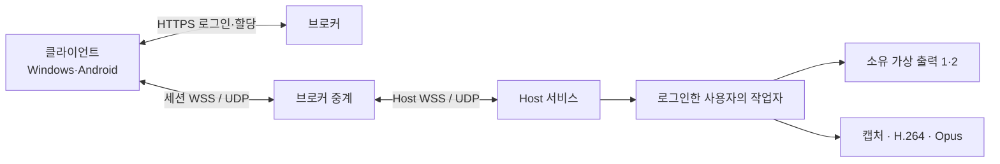

# Multitap 스트리밍

Multitap 스트리밍은 Multitap이 직접 만든 스트리밍 엔진의 기술 이름이다. Windows VM(또는 PC)의 작업 화면을 Multitap이 소유한 가상 디스플레이로 만들고, 클라이언트 창 크기·입력·소리·장치 공유를 인증된 원격 세션 하나에서 다룬다. 앱의 연결 버튼과 메뉴는 `스트리밍`으로 표시하고, 기술 이름은 연결 통계의 기술 정보와 개발 문서에만 쓴다.

VMware Horizon의 Blast는 사용감과 성능의 참고 대상일 뿐이다. Multitap 스트리밍은 Blast와 서로 접속되는 프로토콜이 아니다. Sunshine, Moonlight 같은 다른 제품을 따로 설치하지 않으며, 엔진과 라이브러리는 클라이언트와 Host에 들어 있다.

전체 구조는 [ARCHITECTURE.md](../ARCHITECTURE.md), 메시지와 제한은 [원격 세션 프로토콜](remote-session-protocol.md)에 있다.

클라이언트와 Host는 모두 브로커 쪽으로만 연결한다. 같은 LAN에 있을 필요가 없고, 어느 쪽도 포트를 열 필요가 없다(UDP 경로를 쓰려면 브로커 서버의 UDP 포트만 연다).

## 구성

| 영역 | 동작 |
|---|---|
| 인증·중계 | ID/비밀번호 로그인, 서버가 정한 VM 할당. 브로커가 세션 중에도 권한을 확인하고, 할당이나 권한이 회수되면 세션을 끝낸다. |
| 화면 | 클라이언트 모니터 하나에 소유 가상 출력 하나(1개 또는 2개). 스트리밍하는 동안 다른 화면(Proxmox 콘솔, vGPU 출력, 물리 모니터)은 끄고, 끝나면 저장해 둔 상태로 되돌린다. 준비된 소유 출력이 없으면 콘솔이나 물리 화면으로 대신하지 않고 연결 불가 사유를 알린다. [디스플레이 관리자 v2](display-manager-v2.md), [두 모니터](dual-monitor-design.md) |
| 해상도 | 창 크기가 바뀌면 가상 출력의 실제 Windows 모드를 바꾸고, 새 영상 세대(epoch)와 키 프레임으로 이어 간다. 화면을 늘리거나 잘라서 맞추지 않는다. Windows 배율은 100~200 % 다섯 단계에서 고른다. |
| 영상 | H.264, NV12 4:2:0. 기본은 x264(CPU), GPU가 있으면 NVENC나 AMF, 실패하면 같은 시점의 키 프레임부터 Microsoft 소프트웨어 인코더로 바꾼다. 새 연결은 60 fps와 자동 비트레이트(최대 100 Mbps)로 시작한다. 멈춘 영역은 무손실 타일(`tiles-v1`)로 선명하게 보강한다. [x264 인코더](x264-encoder.md), [기본값](stream-default-profile.md), [무손실 타일](lossless-tiles-design.md) |
| 전송 | 기본은 WSS. Host, 클라이언트, 브로커가 모두 지원하면 영상과 소리는 브로커의 UDP 중계(`udp-media-v1`, 세션별 AES-256-GCM)로 옮기고, 문제가 생기면 WSS로 돌아간다. 혼잡과 손실에 따라 비트레이트를 조정한다. [적응형 비트레이트](adaptive-bitrate.md) |
| 입력 | 키보드, 마우스, 터치, 한글 입력. 원격 화면에 포커스가 있으면 Windows 단축키도 VM으로 보내고, 포커스를 잃거나 연결이 끊기면 눌린 키와 버튼을 놓는다. **마우스 잠금**을 켜면 마우스를 VM에 넘겨 상대 이동을 보내고, USB 권한이 있으면 가상 USB HID 마우스를 쓴다. [입력 반응성](input-responsiveness.md) |
| 소리 | VM의 소리를 WASAPI로 캡처해 Opus로 보낸다. VM에 소리 장치가 있어야 한다(Proxmox VM 사운드 카드). |
| 장치 공유 | 클립보드(텍스트·파일), 드라이브, 프린터, USB. 관리자가 사용자×VM마다 허용해야 하며 기본은 모두 차단이다. [장치 공유](streaming-redirection.md) |

Host 서비스가 브로커에 연결되어 있다는 것과 로그인·잠금·UAC 화면을 스트리밍할 수 있다는 것은 다르다. 관리자 권한으로 실행된 일반 앱(작업 관리자 등)의 입력과 보안 데스크톱 지원은 따로 다룬다.

## 기능 협상

새 기능은 Host가 능력을 알리고, 클라이언트가 요청하고, 브로커가 허용한 것만 켠다. 제품 이름이나 버전 문자열로 기능을 짐작하지 않는다. 접속 요청은 `mode:'stream'`이며, 미디어 전송은 `media-v1`과 협상된 `media-epoch-v1`을 쓴다. 이미 배포된 Host나 브로커가 모르는 기능은 요청하지 않거나 거절된다.

## 클라이언트 표시 경로 (texture-pacing-v1)

Flutter는 화면 갱신마다 프레임을 하나만 가져간다. 새 프레임이 기다리던 프레임을 바로 덮어쓰면, 한 갱신 간격 안에 두 프레임이 도착할 때 앞 프레임이 한 번도 보이지 않는다. 그래서 Windows 클라이언트(`windows/runner/remote_engine.h`)는 이렇게 한다.

- 기다리는 프레임이 있으면 새 프레임은 뒤에 줄을 선다(최대 2개). 두 번 연속 가져갈 때마다 대기가 남아 있거나(계속 밀림), 100 ms보다 오래된 프레임이면 가장 새 프레임만 보여 준다. 순간적으로 몰릴 때만 한 프레임이 최대 한 갱신 간격 늦게 보인다.
- 무손실 타일 재게시는 기다리는 프레임을 대신하고, 다음 영상 프레임이 다시 대신한다.
- 텍스처는 CPU 픽셀 버퍼(`texturePath` 0) 또는 GPU 표면(`texturePath` 1)이다.
- 연결 통계에는 디코딩부터 Flutter가 가져갈 때까지의 대기(`textureWaitUs`), 업로드 시간, 대기·건너뛴 프레임 수, GPU 여부, 화면 주기(`displayHz`), 클라이언트가 원격 데스크톱 세션 안에서 실행 중인지(`remoteSession`)를 숫자와 참/거짓으로만 보낸다. 어댑터 이름이나 ID는 보내지 않는다. 원격 데스크톱 세션 안에서는 화면 주기가 낮을 수 있고(예: 32 Hz), Flutter도 그보다 빨리 그리지 않는다.

## 하지 않는 것

- HEVC, AV1, 4:4:4나 10비트 영상, 전체 화면의 무손실 인코딩은 지원하지 않는다.
- 카메라와 마이크 리디렉션은 만들지 않는다.
- 화면을 늘려 채우는 것으로 실제 해상도 변경을 대신하지 않는다.

성능 목표는 Horizon급 반응성과 선명도다. 같은 VM 자원·해상도·회선·장면에서 새 프레임과 입력 후 실제 표시 시간을 측정하기 전에는 같은 성능이나 우위를 주장하지 않는다. 측정 항목은 [스트림 관측](stream-observability.md)에 있다.
